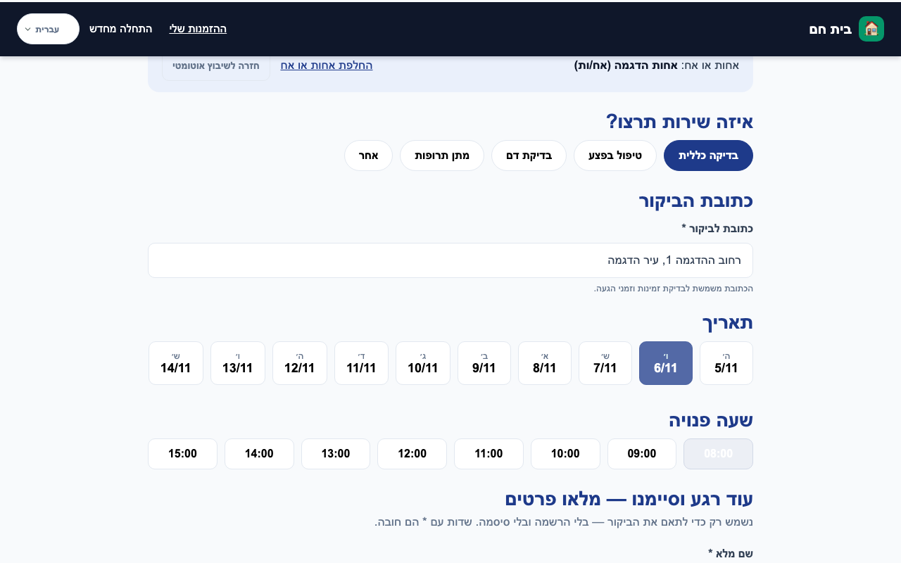
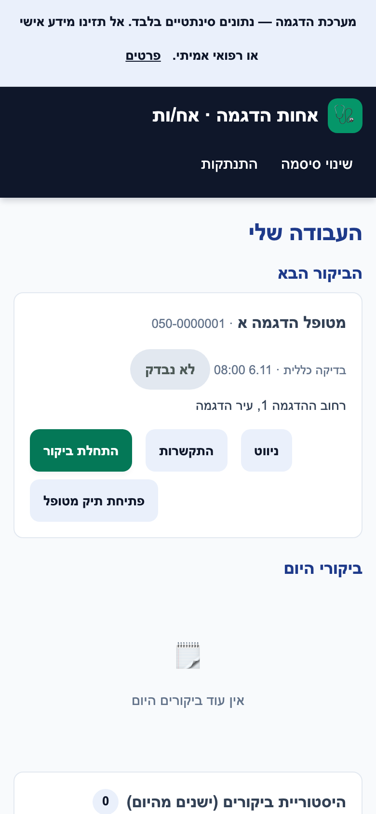
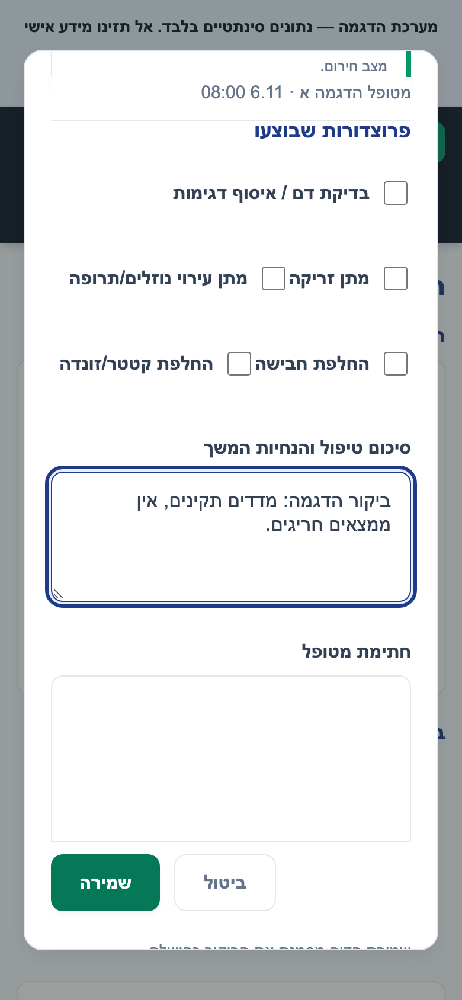
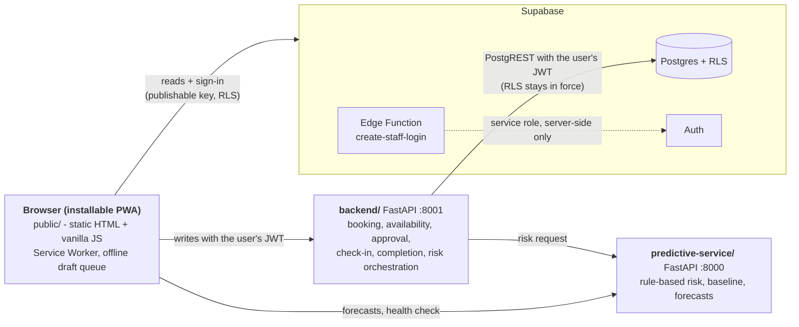

# Home Care CRM

[](https://github.com/diabhelal/home-care-crm/actions/workflows/ci.yml)


**Booking, visit documentation and rule-based risk flagging for home-healthcare teams.**
A patient requests a visit without registering, an administrator approves and assigns it, a nurse documents the visit (even without signal), and the system flags worrying vital-sign patterns with transparent, hand-written clinical rules.

> **Status: working prototype, built as a final-year project with a path toward a commercial product. Synthetic data only.** It is not a certified medical device and is not approved for real patients. The risk indicator is decision support, not diagnosis, and there is **no trained or clinically validated machine-learning model**. See [Development status](#development-status) for exactly what is on `main`, what is in review, and what is only proposed. The requirements and their status are in the [specification](docs/SPECIFICATION.md).

<p align="center">
  
</p>
<p align="center">
  
  &nbsp;&nbsp;
  
</p>
<p align="center"><sub>Synthetic data only; Hebrew right-to-left interface. Top: patient booking (desktop). Bottom: nurse on a phone. Regenerated on 2026-11-05 from the current <code>main</code> UI by the mocked demo test (<code>tests/e2e/demo-journey.spec.js</code>); they can lag later UI changes. The "demo system" banner is part of the demo mode.</sub></p>

**Contents:** [Problem](#the-problem) · [Features](#features) · [Architecture](#architecture) · [Technology](#technology) · [Clinical analytics](#clinical-analytics) · [Security and privacy](#security-and-privacy) · [Offline behaviour](#offline-behaviour) · [Getting started](#getting-started) · [Testing and quality](#testing-and-quality) · [Project structure](#project-structure) · [Development status](#development-status) · [Roadmap](#roadmap) · [Documentation](#documentation) · [Disclaimer](#disclaimer)

## The problem
Home-care agencies coordinate nurses, doctors and caregivers who visit patients at home. Much of this still runs on phone calls and paper: patients cannot see availability, the office double-books staff, travel time between visits is ignored, documentation is lost when there is no signal, and nobody is alerted when a patient's measurements start to look worrying.

This project is a small CRM for that workflow. It is also a deliberate exercise in three things: a real Postgres row-level-security model, a guest-checkout identity pattern (booking without an account), and an honestly scoped decision-support feature that uses transparent rules instead of an unsupported "AI" claim.

## Features
Everything below is on `main` unless marked otherwise. Evidence is automated tests; see [Testing and quality](#testing-and-quality).

| For | Capability |
|---|---|
| **Patient** (no account needed) | Book a visit by choosing service, address, day and time; name, national ID and phone are asked only at the last step (an anonymous session is created in the background). The booking is a *request* with an order number. Optional history saving by email + password. Patient pages are localized (Hebrew, English, Arabic); phone + SMS login is built but switched off |
| **Nurse / clinical staff** (own login) | Sees only patients assigned to them (enforced by the database). "Next visit" with navigation and call buttons, check-in with **server time**, visit report (six vitals, five procedures, treatment summary, on-screen signature), patient record (allergies, history, notes, medication log, service plans, measurement history), alerts. Works offline |
| **Administrator** | Approve, reject, reassign or cancel requests; manage staff (deactivate rather than delete is in review, see [status](#development-status)); work queue; patient records and timeline; alerts; capacity forecast; trend forecast per patient |
| **System** | Server-side availability from each staff member's weekly schedule, existing bookings and a fixed 30-minute travel buffer; conflict checks in both the API and database triggers; atomic visit completion; risk assessment computed server-side and HMAC-attested before it is stored |

## Architecture

Key design decisions:
- **Browser reads, backend writes.** Reads go to Supabase through RLS. Writes to bookings, visit reports, risk predictions and alerts go through the backend with the caller's own JWT; a service-role key is never used by the app (only the Edge Function holds one, server-side).
- **The database is the last line of defence.** A unique index and triggers refuse double bookings, buffer violations and self-approval even if the API is bypassed.
- **Neither Python service is hosted.** Both run locally; hosting with HTTPS is on the [roadmap](#roadmap).

## Technology
| Layer | Used | Not used |
|---|---|---|
| Frontend | Static HTML/CSS, vanilla JavaScript, `supabase-js` v2 (CDN), Service Worker, Web App Manifest, RTL design (Heebo) | React or any framework, a build step |
| Backend | Python 3.12+, FastAPI, Pydantic, Uvicorn, `httpx` (PostgREST) | Docker, a service-role key |
| Analytics | FastAPI service, NumPy/pandas, `statsmodels` (ARIMA), scikit-learn scaffolding (inactive) | A trained model |
| Data | Supabase: Postgres, Auth, RLS, PostgREST, one Deno Edge Function | Realtime |
| Quality | `node --test`, Playwright (mocked), pytest, isolated local Postgres, GitHub Actions, secret scan, Dependabot | |

## Clinical analytics
The Green / Yellow / Red indicator, trend, baseline and forecasts are **hand-written clinical rules and classical statistics**.

| Component | What it is | Status |
|---|---|---|
| Per-vital classification and worst-of risk level | Fixed thresholds, deterministic | Active. Thresholds are general, **not clinically validated**; a document for clinician review exists |
| Personal baseline and anomaly detection | Medians, percentage and standard-deviation rules | Active; parameters not clinically validated |
| Trend and capacity forecast | Linear regression; ARIMA from 8 measurements | Active; shows "insufficient data" with short histories |
| Supervised ML targets (`ml_targets.py`) | Architecture only: no trained artifacts exist | Inactive. Returns "model not available" instead of inventing a probability |
| LSTM (`lstm_interface.py`) | Placeholder | Not implemented |

An assessment is computed by the backend, attested with an HMAC, and only then stored. Details: [`docs/RISK_ENGINE.md`](docs/RISK_ENGINE.md); thresholds for medical review: [`predictive-service/CLINICAL_THRESHOLDS_FOR_REVIEW.md`](predictive-service/CLINICAL_THRESHOLDS_FOR_REVIEW.md). The system does not predict or diagnose specific medical events and has no automatic emergency alerting.

## Security and privacy
**Implemented on `main`**
- Row-level security on every table; `anon` has no table grants. Patients see their own rows, staff their assigned patients, administrators everything (`app_metadata.is_admin`, settable only through the Auth Admin API).
- The browser holds only the publishable key; no direct browser writes to the critical tables.
- Risk predictions and alerts require a backend-produced HMAC; authorship and server time are set by the server.
- Patient-record screens are isolated per patient (a stale response from a previous patient is discarded); covered by a dedicated test suite.
- Free text is HTML-escaped; CI scans the full history for secrets and a pre-commit hook blocks them.

**Known gaps (not yet closed)**
- Offline drafts live in `localStorage`, separated per user but **not encrypted**.
- Anonymous booking has no CAPTCHA; MFA and leaked-password protection are not enabled.
- Migrations `008`-`013` (and the later proposals) exist and are tested on a throwaway database but are **not applied to the live database**. Based on the migration files, administrators there can still physically delete clinical rows such as visit reports; the proposals block this. The live state was last read on 2026-10-31. See [Development status](#development-status).
- No privacy policy, consent flow, penetration test or legal review. Real use would also need hosting with HTTPS.

Full text: [`docs/SECURITY_ARCHITECTURE.md`](docs/SECURITY_ARCHITECTURE.md), [`docs/REVIEW.md`](docs/REVIEW.md), [`SECURITY.md`](SECURITY.md) (how to report an issue).

## Offline behaviour
- **Implemented on `main`:** a nurse can write a visit report without signal. The draft is stored locally per user, synchronized when the connection returns, and removed only after the server confirms the save. A different account on the same device never sees or overwrites another user's drafts.
- **In review:** an explicit "not confirmed by the server" state after a server error or timeout with a safe retry button ([#33](https://github.com/diabhelal/home-care-crm/pull/33)); requesting the risk assessment after a verified duplicate save ([#27](https://github.com/diabhelal/home-care-crm/pull/27)); admin scripts in the cached app shell ([#32](https://github.com/diabhelal/home-care-crm/pull/32)).
- **Limitations:** drafts are not encrypted ([gap above](#security-and-privacy)); only the app shell is cached, not patient data; booking itself needs a connection.

## Getting started
**Prerequisites:** Python 3.12+ (developed on 3.13), Node.js 20+, a browser. `public/config.js` already points at the project's Supabase URL with a publishable key (synthetic data); to use your own project edit it (publishable key only, never a secret).

**Fastest look, no Supabase and no backend** - the mocked end-to-end journey patient -> admin -> nurse:
```bash
npm install && npx playwright install chromium
npx playwright test tests/e2e/demo-journey.spec.js     # screenshots land in docs/demo-proof/
```

**Run the system locally (three terminals):**
```bash
# 1. frontend  ->  http://localhost:8080/index.html
cd public && python3 -m http.server 8080

# 2. backend   ->  health: http://localhost:8001/healthz
cd backend && python3 -m venv .venv && source .venv/bin/activate
pip install -r requirements.txt -r requirements-dev.txt     # pinned set: requirements.lock.txt
cp .env.example .env                                        # fill in the values (git-ignored)
uvicorn app.main:app --port 8001 --env-file .env

# 3. predictive service (optional)  ->  health: http://localhost:8000/health
cd predictive-service && python3 -m venv .venv && source .venv/bin/activate && pip install -r requirements.txt
uvicorn main:app --port 8000
```
Without the backend, booking shows "service unavailable" by design. Without the predictive service, a banner says so and the rest keeps working.

**Configuration (no secrets in Git):** the frontend reads `public/config.js` (`SUPABASE_URL`, publishable key, `BACKEND_URL`, `PREDICTIVE_SERVICE_URL`, `SMS_LOGIN_ENABLED`, `DEMO_MODE`). The backend reads `backend/.env` (template: `backend/.env.example`). Full variable table: [`docs/HOW_IT_WORKS.md`](docs/HOW_IT_WORKS.md) and [`backend/README.md`](backend/README.md).

## Testing and quality
Measured on `main` at `131dd85` on 2026-11-05:

| Suite | Command | Result |
|---|---|---|
| JavaScript unit | `node --test tests/unit/*.test.js` | 57 pass |
| Mocked browser (Playwright) | `ls tests/e2e/*.spec.js \| grep -vE "/(booking\|visit-report)\.spec\.js$" \| xargs npx playwright test` | 82 pass (18 spec files) |
| Backend | `cd backend && pytest -q --ignore=tests_db` | 139 pass |
| Database (throwaway Postgres, no Docker) | `cd backend && pytest tests_db -q` | 95 pass (checked on Postgres 16 and 18) |
| Migration proposals | `python backend/scripts/verify_proposed_sql.py` | applies, re-applies and rolls back every proposal |
| Predictive service | `cd predictive-service && pytest -q` | 17 pass |

**CI** (`.github/workflows/ci.yml`) runs on every push: secret scan over the full history, unit tests, predictive-service tests, backend + isolated-database tests, and 16 of the mocked Playwright specs. **Known exclusions:**
- `booking.spec.js` and `visit-report.spec.js` write to a real database; they are manual-only and must never run against the live project (a dedicated test project does not exist yet).
- The patient-isolation and trend-forecast specs pass locally but are not yet in the CI list.
- Not tested: real-browser accessibility tooling, a screen reader, and the complete patient-request-to-completion path on a hosted deployment.

## Project structure
```
public/               static frontend: pages, js/admin/, js/shared/, app.js, service-worker.js, manifest
backend/              FastAPI service: app/, tests/, tests_db/ (isolated Postgres), scripts/
predictive-service/   rule-based clinical engine + inactive ML scaffolding
supabase/             migrations/ (23, match the live project), proposed/ (not applied), functions/
tests/                unit/ (node) and e2e/ (Playwright, mocked)
docs/                 architecture, database, risk engine, security, status, demo
.github/              CI workflow, Dependabot
.claude/              project agents and skills for the AI assistant (working aids, not product code)
```
File-by-file frontend tree: [`docs/HOW_IT_WORKS.md`](docs/HOW_IT_WORKS.md). Folder responsibilities and what must be preserved: [`docs/PROJECT_MAP.md`](docs/PROJECT_MAP.md).

## Development status
`main` is the authoritative implemented baseline. Anything else below is **not** part of it.

| State | What |
|---|---|
| **On `main`** | Everything in [Features](#features); isolation fixes for patient records and visit reports; trend-forecast button fix; rule-based risk engine; offline drafts; CI |
| **On `main`, database part not applied** | Staff deactivation instead of deletion, measurement history, risk-status age, amendments to completed reports, patient archive and record export (UI and tests on `main`; SQL `009`, `011`-`013` not applied to the live database) |
| **Open pull requests (not merged; CI state per PR in [`docs/REPO_STATUS.md`](docs/REPO_STATUS.md))** | Offline-draft safety ([#27](https://github.com/diabhelal/home-care-crm/pull/27), [#33](https://github.com/diabhelal/home-care-crm/pull/33)); Service Worker ([#32](https://github.com/diabhelal/home-care-crm/pull/32)); backend reliability ([#25](https://github.com/diabhelal/home-care-crm/pull/25), [#28](https://github.com/diabhelal/home-care-crm/pull/28)); predictive input validation and wording ([#24](https://github.com/diabhelal/home-care-crm/pull/24)); no physical delete in the UI and author-only amendments ([#31](https://github.com/diabhelal/home-care-crm/pull/31)); admin can pause a service such as blood tests ([#35](https://github.com/diabhelal/home-care-crm/pull/35)); test harness ([#29](https://github.com/diabhelal/home-care-crm/pull/29)); opt-in LLM visit-summary draft ([#18](https://github.com/diabhelal/home-care-crm/pull/18)) |
| **Proposed SQL, tested on a throwaway database, not applied** | `008`-`013`; `015`-`019` record integrity, archive/void and access rules ([#30](https://github.com/diabhelal/home-care-crm/pull/30)); `021` service availability (#35). The live database has 23 migrations. Apply status per file: [`supabase/proposed/APPLIED.md`](supabase/proposed/APPLIED.md) |
| **Not built** | Hosting with HTTPS, MFA, privacy and consent documents, penetration test, validated ML model, real-time updates, external alerting (email/SMS/phone) |

The complete branch/PR map, merge order, version-cache coordination and test evidence: [`docs/REPO_STATUS.md`](docs/REPO_STATUS.md). The stabilisation plan: [`docs/STABILIZATION_PLAN.md`](docs/STABILIZATION_PLAN.md).

## Roadmap
Items marked *(owner)* need a decision or approval.
1. Review and merge the open PRs in the order given in [`docs/REPO_STATUS.md`](docs/REPO_STATUS.md) *(owner)*.
2. Apply the proposed migrations to the live database one at a time, after a verified backup *(owner approval for each)*.
3. Close the visible-safety gaps found in review: show data-load failures in the staff screen, show the risk result after saving a report, confirm before discarding a visit report.
4. Encrypt offline drafts without any risk of losing unsent clinical text (design and key-recovery options first *(owner)*).
5. Host the backend and predictive service with HTTPS; add CAPTCHA, MFA and leaked-password protection.
6. Clinical review of thresholds and wording by a licensed professional; a dedicated test project so the live-database specs can run.

## Documentation
| Document | Purpose |
|---|---|
| [`docs/SPECIFICATION.md`](docs/SPECIFICATION.md) | **Baseline specification** (Hebrew): scope, roles, requirements with fixed IDs, acceptance criteria linked to tests, status per requirement, open decisions, contradictions. Written after the fact for the existing system |
| [`docs/REPO_STATUS.md`](docs/REPO_STATUS.md) | Branch and PR map, merge order, test evidence, what is open |
| [`docs/HOW_IT_WORKS.md`](docs/HOW_IT_WORKS.md) | Workflows, booking flow, visit reports, setup and variable table |
| [`docs/DATABASE.md`](docs/DATABASE.md) | Tables, RLS, migration status |
| [`docs/RISK_ENGINE.md`](docs/RISK_ENGINE.md) | What is rules, statistics and ML, and the limits |
| [`docs/SECURITY_ARCHITECTURE.md`](docs/SECURITY_ARCHITECTURE.md), [`docs/REVIEW.md`](docs/REVIEW.md), [`SECURITY.md`](SECURITY.md) | Security model, review findings, reporting a vulnerability |
| [`docs/STAGING_PLAN.md`](docs/STAGING_PLAN.md), [`DEPLOY.md`](DEPLOY.md) | Applying migrations with rollback; deployment plan (not done) |
| [`backend/README.md`](backend/README.md), [`tests/e2e/README.md`](tests/e2e/README.md) | Backend run and configuration; which browser specs are safe to run |
| [`docs/DEMO.md`](docs/DEMO.md), [`HANDOFF.md`](HANDOFF.md) | Demo script (Hebrew); where the project stands and how to continue (Hebrew) |
| [`CLAUDE.md`](CLAUDE.md) | Working rules for contributors and the AI assistant, including the documentation policy |

## Disclaimer
The risk indicator, trend detection and forecasts are **decision-support and prototype functionality only**: hand-written threshold rules and arithmetic, not a clinically validated diagnostic tool and never a substitute for a qualified healthcare professional. Do not use this project as-is to make real clinical decisions or to store real patient data.
