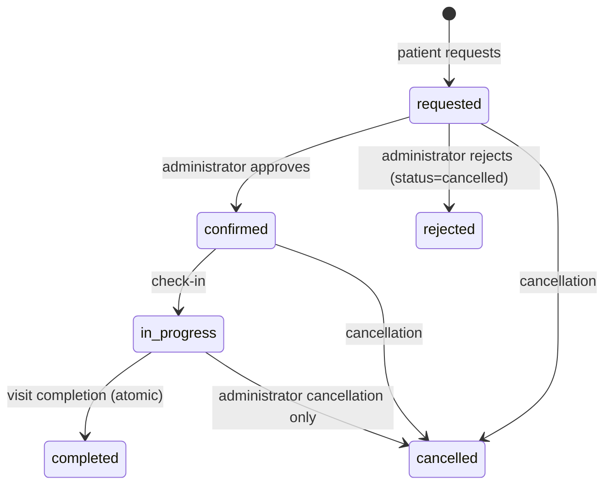

# System Specification — Home Care CRM

> **A baseline specification, compiled now for an existing system.** This document was written after development, based on the code in `main`, the project documents and the owner's decisions. **Development was not carried out according to it, and no one should claim that it was.** From here on it defines the required behavior, the acceptance criteria, and what has been implemented, tested and activated in practice.
> **As of:** 2026-11-05 · **Baseline:** `main` @ `8afecfc` · **Owner:** the product manager (the project serves both as a commercial product and as a final-year project).
> This document **does not choose any new business or clinical policy**. Whatever has not been decided appears in the section [Open decisions](#11-open-decisions). It is not a substitute for the technical documents; it points to them.

**Contents:** [1 Purpose](#1-product-purpose) · [2 Scope](#2-product-scope) · [3 Roles and workflows](#3-user-roles-and-workflows) · [4 Conventions](#4-document-conventions) · [5 Functional requirements](#5-functional-requirements) · [6 Non-functional requirements](#6-non-functional-requirements) · [7 Permissions](#7-permissions) · [8 Visit states](#8-visit-states-and-transitions) · [9 Medical records, offline, risk and AI](#9-medical-records-offline-sync-and-risk--ai) · [10 Acceptance and traceability](#10-acceptance-criteria-and-traceability) · [11 Open decisions](#11-open-decisions) · [12 Contradictions](#12-contradictions-and-gaps-found) · [13 Limitations](#13-limitations) · [14 Maintenance](#14-specification-maintenance)

## 1. Product purpose
**Primary purpose:** to run the owner's home-visit business. The system replaces telephone coordination and paper with a single process: a patient requests a service, an administrator approves and schedules, a staff member performs and documents the visit, and the system flags concerning measurements according to transparent rules.

**Secondary purpose:** the ability to adapt the system to other businesses in the future. Today there are only **configuration points** (offered service types, eligible roles, time zone, travel buffer; see `NFR-ADP-01`). The system is **a single instance for a single business** and has no multi-tenancy. The adaptation strategy has not been decided ([O-11](#11-open-decisions)).

**What the system is not:** a medical device, a diagnostic tool or an emergency alert system. The risk indicator is decision support only. There is no trained machine-learning model.

## 2. Product scope
**In scope (exists in `main` or is defined as a requirement in sections 5-9):**
- Visit request without registration, approval and scheduling by an administrator, execution and documentation by staff (including without connectivity), patient record, alerts, rule-based risk assessment, trend and capacity forecasts.
- An interface for three roles: patient, staff member (currently nurses), administrator.

**Currently out of scope (not built and not decided to be built):**
- Multi-tenancy, billing and payments, pricing and service area, integration with external systems (health funds, laboratories).
- External notifications (email, SMS, phone), real-time updates, GPS tracking.
- A trained, clinically validated machine-learning model; diagnosis.
- Production operation with real patients: hosting with HTTPS, privacy policy and consent, penetration testing, legal review (see [O-03](#11-open-decisions), [O-10](#11-open-decisions)).
- User roles beyond patient, staff and administrator (for example a family member, tiered permissions).

## 3. User roles and workflows
| Role | Identity | What they can do (in brief) |
|---|---|---|
| **Patient** | Anonymous browser session (optional: email and password; SMS is built and turned off) | Requests a visit, sees and cancels their own bookings |
| **Staff member** | Personal login (`medical_staff.auth_user_id`); currently nurses | Sees assigned patients, starts a visit, documents it, sees alerts |
| **Administrator** | `app_metadata.is_admin = true` | Approves, rejects, schedules, cancels, manages staff, sees all records, can act on behalf of staff |
| **System** | Backend using the caller's JWT; Edge Function using the service role | Enforces rules; the backend does not use the service role |

**The central business process:**
1. **A patient requests a service:** chooses a service, an address, a day and an available time, and enters name, national ID and phone in the last step. A request is created in the "התבקש" ("requested") state, with a booking number.
2. **An administrator approves and schedules:** approves or rejects. Rejection releases the slot. A booking can be reassigned to a suitable, available staff member.
3. **Staff perform and document:** start a visit (server time), fill in a report (measurements, procedures, summary, signature), and save. Completion and risk assessment happen on the server, and an alert is created according to the rules.
4. **The administrator and the patient see the result:** the administrator sees the record, risk and alerts; the patient sees the booking status.

Flow details: [`docs/HOW_IT_WORKS.md`](HOW_IT_WORKS.md).

## 4. Document conventions
**Permanent identifiers.** A requirement is identified as `FR-<area>-<number>` (functional) or `NFR-<area>-<number>` (non-functional). An identifier never changes and is never reused, even if the requirement was cancelled (it is then marked "Cancelled"). Open decisions: `O-nn`; contradictions: `C-nn`.

**Status.** Each requirement shows the highest stage reached, with a caveat where needed. The status keywords are validated by `scripts/check_docs.py`:
| Status | Meaning |
|---|---|
| **Planned** | Not in `main`: an open PR, an SQL proposal that has not been applied, or a decision not yet implemented |
| **Implemented** | The code is in `main`, with no dedicated automated test |
| **Tested** | The code is in `main` and there are automated tests that pass (referenced in the tests column). The scope is stated: tests with mocked data, or a disposable Postgres |
| **Activated** | Operating in a defined environment. **The only environment** is the live Supabase project with synthetic data, and only for the database components that were applied (the original migrations and `001`-`007`, 2026-10-15). The backend service and the forecast service are **not hosted**, so no requirement is "activated" in them |

**Sources of evidence.** Code in `main`; project documents (`docs/DATABASE.md`, `supabase/proposed/APPLIED.md`); tests. The state of the live database was taken from the documents (checked read-only on 2026-10-31) and was not re-checked when this document was written. `docs/REVIEW.md` notes a single manual run of a booking cycle against the live database on 2026-10-15; it was not saved as a test and is not counted here as evidence.

**Table structure.** Each area has two tables in the same order: a requirements table (requirement, acceptance criterion, status) and a traceability table (implementation and tests) for the same identifiers.

**Test references.** `file::test_name` points to an existing test function. A file alone points to a whole test file (the test names are in Hebrew). References to open PRs appear as text only, because the files are not in `main`.

## 5. Functional requirements
### 5.1 Booking a visit (patient) — `FR-BK`
| ID&nbsp;&nbsp;&nbsp;&nbsp;&nbsp;&nbsp;&nbsp;&nbsp;&nbsp; | Requirement | Acceptance criterion | Status |
|---|---|---|---|
| `FR-BK-01` | A patient books without registering; personal details only in the last step | A new patient completes a booking without a password; an anonymous session is created; a booking number is shown | Tested (mocked) |
| `FR-BK-02` | The request is created as "requested, awaiting approval"; the patient's identity is taken from the JWT and identifiers in the request body are ignored; on direct writes the DB forces `requested` | A request with forged `patient_id`/`staff_id` is stored under the caller; a patient cannot approve for themselves | Activated (DB trigger, `005`) |
| `FR-BK-03` | Only offered visit types. Defaults: general checkup, wound care, blood test, medication administration, other | A type not on the list is rejected with 400 `purpose_not_offered`; the offering in the UI is set in the configuration | Tested |
| `FR-BK-04` | A visit address is mandatory (3-300 characters); notes up to 1000 | A request without an address is rejected with 422 | Tested |
| `FR-BK-05` | A repeated request with the same `Idempotency-Key` returns the same booking, with no duplicate; the key is separate for each patient | A double submission = one booking; after a lost response the same key is sent | Tested; Activated (DB index) |
| `FR-BK-06` | Availability is computed on the server: slots according to the staff member's weekly schedule; a **30-minute travel buffer** between different addresses; consecutive visits at the same address are allowed; an unknown address counts as different; overlap is always blocked; a cancelled booking is not counted | A slot within 30 minutes of a visit at a different address is not offered; exactly at the 30 boundary it is allowed | Tested |
| `FR-BK-07` | Double booking is prevented in the API (409 `slot_taken`) and in the DB (unique index and buffer trigger), even if the API is bypassed | Two requests for the same slot: one succeeds; a Hebrew message; on a direct write the DB rejects | Tested; Activated (`005`, on insert) |
| `FR-BK-08` | The same overlap and buffer checks also when updating an existing booking (changing time, address, staff member) | An update that creates an overlap or breaches the buffer is rejected by the DB, including under concurrent contention | Planned (tested on a disposable DB; not applied) |
| `FR-BK-09` | Deterministic automatic assignment when no staff member is chosen: available and suitable; preference for low daily load; proximity when coordinates exist; otherwise the lowest identifier | The same state yields the same assignment on every run; a busy staff member is not chosen | Tested (proximity: no geocoder by default) |
| `FR-BK-10` | Only eligible roles (`ELIGIBLE_ROLES`, default: nurses) and active staff members can be booked | An ineligible staff member is not offered and cannot be selected; a deactivated one is not offered | Tested. Also blocked in the DB: see FR-MR-09 |
| `FR-BK-11` | Booking only on a working day and at a time on the staff member's slot grid | A request outside a working day or off the grid is rejected | Tested |
| `FR-BK-12` | A patient cancels their own booking until the visit starts; someone else's booking appears as "not found" (no leak of its existence); a completed visit cannot be cancelled; repeated cancellation is not an error | According to the tests; the slot is released | Tested |
| `FR-BK-13` | The patient sees a single state: "התבקש" (requested), "אושר" (approved), "בביצוע" (in progress), "הושלם" (completed), "בוטל" (cancelled), "לא אושר" (not approved) | "התבקש" is not shown as "אושר"; display order follows `display_state` | Tested |
| `FR-BK-14` | "ההזמנות שלי" ("My bookings") and rebooking with the same staff member and service | Rebooking leads to the booking page with the same staff member and purpose | Tested (mocked) |
| `FR-BK-15` | Saving history in an email-and-password account (optional); signing in from a second device. SMS is built and turned off (`SMS_LOGIN_ENABLED=false`) | Upgrading a guest keeps the bookings; with SMS off there is no phone selector | Tested (mocked). SMS: not activated (no provider) |
| `FR-BK-16` | Backend or network failure: a clear message, and no booking is created or shown | Empty `BACKEND_URL`, backend down or timeout: no confirmation and no booking | Tested (mocked) |
| `FR-BK-17` | The patient pages are in Hebrew, English and Arabic | Switching language changes texts and visit-type labels | Implemented |
| `FR-BK-18` | The administrator can pause a service (for example blood tests) for a date range or until resumed, with a message to the patient; existing bookings are not affected; enforcement is also in the backend and the DB | A paused service cannot be selected on the paused dates; a direct request is rejected with 409 | Planned |

<b>Traceability to implementation and tests</b> (`file::test` references are checked automatically)

| ID&nbsp;&nbsp;&nbsp;&nbsp;&nbsp;&nbsp;&nbsp;&nbsp;&nbsp; | Implementation | Tests |
|---|---|---|
| `FR-BK-01` | `public/booking.html` `public/app.js` `backend/app/main.py` | `tests/e2e/backend-booking.spec.js` `tests/e2e/patient-account.spec.js` `backend/tests/test_api.py::test_guest_can_request_starts_requested` |
| `FR-BK-02` | `backend/app/service.py`, trigger `bookings_guard_insert` (`005`) | `backend/tests/test_api.py::test_spoofed_ids_ignored` `backend/tests/test_api.py::test_spoofed_staff_identity_in_body_ignored` `backend/tests_db/test_db_guards.py::test_patient_insert_is_forced_to_requested` |
| `FR-BK-03` | `backend/app/config.py` (`OFFERED_PURPOSES`), `public/config.js` (`SERVICE_CONFIG`) | `backend/tests/test_api.py::test_purpose_not_offered` `tests/e2e/staff-convenience.spec.js` |
| `FR-BK-04` | `backend/app/models.py` | `backend/tests/test_api.py::test_address_required` |
| `FR-BK-05` | Unique index `bookings_patient_idempotency_key_uidx`; `backend/app/service.py` | `backend/tests/test_api.py::test_idempotency_same_key_same_booking` `backend/tests/test_api.py::test_idempotency_scoped_per_patient` `tests/e2e/backend-booking.spec.js` |
| `FR-BK-06` | `backend/app/scheduling.py` `GET /availability` | `backend/tests/test_scheduling.py` `backend/tests/test_api.py::test_availability_buffer_applies_to_different_address` `tests/e2e/booking-taken-slots.spec.js` |
| `FR-BK-07` | `backend/app/service.py`, triggers `005` | `backend/tests/test_api.py::test_double_booking_409_hebrew` `backend/tests/test_api.py::test_db_unique_violation_maps_to_409` `backend/tests_db/test_db_guards.py::test_double_booking_same_slot_is_blocked` `backend/tests_db/test_db_guards.py::test_travel_buffer_enforced_in_db` |
| `FR-BK-08` | Proposal `010_booking_update_conflict_guard.sql` | `backend/tests_db/test_booking_update_conflicts.py` |
| `FR-BK-09` | `backend/app/scheduling.py` (`rank_key`), `backend/app/service.py` | `backend/tests/test_api.py::test_auto_assignment_deterministic_lowest_id` `backend/tests/test_api.py::test_auto_assignment_prefers_lower_load` `backend/tests/test_api.py::test_auto_assignment_skips_busy_staff` `backend/tests/test_api.py::test_auto_assignment_proximity_when_coords` |
| `FR-BK-10` | `backend/app/config.py` `backend/app/service.py` | `backend/tests/test_api.py::test_non_nurse_staff_not_eligible` `tests/e2e/staff-convenience.spec.js` `tests/e2e/staff-deactivation.spec.js` |
| `FR-BK-11` | `backend/app/scheduling.py` | `backend/tests/test_api.py::test_non_working_day_rejected` `backend/tests/test_scheduling.py::test_working_weekday_and_hours` `backend/tests/test_scheduling.py::test_valid_slot_grid` |
| `FR-BK-12` | `backend/app/state.py` (`cancel_decision`), `backend/app/service.py` | `backend/tests/test_api.py::test_patient_cancels_own_requested_and_frees_slot` `backend/tests/test_api.py::test_other_patient_cannot_cancel_404_and_nothing_changes` `backend/tests/test_api.py::test_patient_cannot_cancel_after_check_in_409` `backend/tests/test_api.py::test_cancel_idempotent` `backend/tests/test_state.py::test_cancel_decision_rules` |
| `FR-BK-13` | `backend/app/state.py` (`display_state`) | `backend/tests/test_state.py::test_display_state` `tests/e2e/backend-booking.spec.js` |
| `FR-BK-14` | `public/my-bookings.html` | `tests/e2e/staff-convenience.spec.js` |
| `FR-BK-15` | `public/i18n.js` `public/my-bookings.html` `public/config.js` | `tests/e2e/patient-account.spec.js` |
| `FR-BK-16` | `public/app.js` (`backendFetch`) | `tests/e2e/backend-booking.spec.js` |
| `FR-BK-17` | `public/i18n.js` | — |
| `FR-BK-18` | PR #35 (not merged); proposal `021` | Tests in PR #35 |

### 5.2 Administrator — `FR-AD`
| ID&nbsp;&nbsp;&nbsp;&nbsp;&nbsp;&nbsp;&nbsp;&nbsp;&nbsp; | Requirement | Acceptance criterion | Status |
|---|---|---|---|
| `FR-AD-01` | Approving and rejecting a request. Approval only for an active booking in the "requested" state; rejection cancels and releases the slot. A patient cannot approve for themselves | A repeated approval returns 409; after rejection the slot is free | Tested; Activated (DB trigger, `005`) |
| `FR-AD-02` | Reassignment only for an active booking that was not rejected, to an eligible and available staff member, with overlap and buffer checks | Assigning to a busy staff member is rejected; losing a race is reported as 409 | Tested |
| `FR-AD-03` | An administrator cancels any booking that was not completed, even after a visit has started | Cancelling a completed booking: 409; repeated cancellation: no error | Tested |
| `FR-AD-04` | `/admin/*` routes for administrators only. An administrator is defined only when `is_admin` is boolean `true` | A non-administrator user gets 403 | Tested |
| `FR-AD-05` | Work queue: new requests are shown first and highlighted; "מי דורש תשומת לב" ("who needs attention") according to risk and alerts; an old red risk does not disappear but is marked "מיושן" ("stale") | According to the test cases | Tested (mocked) |
| `FR-AD-06` | Staff management: add, edit, activate and deactivate. Creating a login for a staff member by invitation through an Edge Function | A deactivated staff member gets no new assignments and the history is kept | Tested (mocked). Delete block in the DB: FR-MR-09 |
| `FR-AD-07` | An administrator can start a visit and complete it on behalf of the assigned staff member; the report remains attributed to the assignment | Check-in and completion by an administrator succeed with server time | Tested |
| `FR-AD-08` | A full patient record for every patient, with search | A record loads by search; switching patients does not show the previous patient's data (FR-RK-08) | Tested (mocked) |
| `FR-AD-13` | An administrator can pause a service (for example blood tests) for a date range or until resumed, with a message to the patient. No row for a service = available. Enforced in the booking form, on the server (409) and in a DB trigger | A booking for a paused service is rejected in all three layers; a service that is not paused is unaffected | Tested (mocked and disposable DB). **Not activated** (לא הופעלה; proposal `021`, not applied) |
| `FR-AD-09` | Capacity forecast for the next month | An estimate is shown according to the input parameters | Implemented |
| `FR-AD-10` | Trend forecast for each patient; a message when there is not enough data or the service is unavailable; another patient's result is not shown | According to the button tests | Tested (mocked) |
| `FR-AD-11` | Archiving a patient without deletion, and exporting a full legal record with an access-log entry and the basis for the request | An export writes a log entry; archiving leaves the history readable | Tested. **Not activated** (לא הופעלה; `013` not applied; the client calls a function that does not exist in the live DB) |
| `FR-AD-12` | Alerts: display, acknowledgement, no duplicate of the same open type | The acknowledgement is recorded on the server | Tested; Activated (`006`) |

<b>Traceability to implementation and tests</b> (`file::test` references are checked automatically)

| ID&nbsp;&nbsp;&nbsp;&nbsp;&nbsp;&nbsp;&nbsp;&nbsp;&nbsp; | Implementation | Tests |
|---|---|---|
| `FR-AD-01` | `backend/app/service.py` `public/js/admin/work-queue.js` | `backend/tests/test_api.py::test_approve_then_reapprove_409` `backend/tests/test_api.py::test_reject_frees_slot` `backend/tests_db/test_db_guards.py::test_admin_can_approve_and_reject` `tests/e2e/backend-booking.spec.js` |
| `FR-AD-02` | `backend/app/service.py` | `backend/tests/test_api.py::test_reassign_rechecks_conflict` `backend/tests/test_api.py::test_reassign_rechecks_buffer` `backend/tests/test_api.py::test_reassign_lost_race_is_reported_as_a_clear_conflict` `tests/e2e/backend-booking.spec.js` |
| `FR-AD-03` | `backend/app/state.py` | `backend/tests/test_api.py::test_admin_cancel_ok_incl_checked_in_and_idempotent` `backend/tests/test_api.py::test_cancel_completed_409` |
| `FR-AD-04` | `backend/app/auth.py` `backend/app/main.py` | `backend/tests/test_api.py::test_admin_routes_forbidden_for_non_admin` `backend/tests/test_auth.py::test_is_admin_must_be_true_boolean` |
| `FR-AD-05` | `public/js/admin/work-queue.js` `public/admin.html` | `tests/e2e/backend-booking.spec.js` `tests/e2e/my-work-pagination.spec.js` `tests/e2e/admin-lifecycle.spec.js` |
| `FR-AD-06` | `public/js/admin/staff.js` `supabase/functions/create-staff-login` | `tests/e2e/staff-deactivation.spec.js` |
| `FR-AD-07` | `backend/app/service.py` (`*_admin`) | `backend/tests/test_api.py::test_complete_by_admin_ok_keeps_booking_staff` `backend/tests/test_api.py::test_checkin_by_admin_ok_server_time_and_idempotent` `tests/e2e/admin-lifecycle.spec.js` |
| `FR-AD-08` | `public/js/admin/patient-record.js` `public/js/admin/patients.js` | `tests/e2e/cross-patient-isolation.spec.js` `tests/e2e/admin-lifecycle.spec.js` |
| `FR-AD-13` | Proposal `021_service_availability.sql`; `backend/app/service.py` `public/js/admin/services.js` | `backend/tests_db/test_service_availability.py` `tests/e2e/service-availability.spec.js` |
| `FR-AD-09` | `public/js/admin/capacity.js` `predictive-service/main.py` (`/predict/capacity`) | — |
| `FR-AD-10` | `public/admin.html` `predictive-service/timeseries.py` | `tests/e2e/trend-forecast.spec.js` |
| `FR-AD-11` | `public/js/admin/patient-record.js`; proposal `013_patient_archive_and_record_export.sql` | `backend/tests_db/test_patient_archive_export.py` `tests/e2e/admin-lifecycle.spec.js` `tests/unit/record-export.test.js` |
| `FR-AD-12` | `public/admin.html` `backend/app/risk.py` | `backend/tests_db/test_risk_and_alerts.py` `backend/tests/test_risk.py::test_open_alert_of_same_type_is_not_duplicated` |

### 5.3 Staff member — `FR-ST`
| ID&nbsp;&nbsp;&nbsp;&nbsp;&nbsp;&nbsp;&nbsp;&nbsp;&nbsp; | Requirement | Acceptance criterion | Status |
|---|---|---|---|
| `FR-ST-01` | A staff member sees only patients assigned to them | A different assignee or a different patient gets 403 or does not see it | Tested; Activated (RLS). **Gap:** [C-05](#12-contradictions-and-gaps-found) |
| `FR-ST-02` | "הביקור הבא" ("Next visit") card: address, allergies, navigation and calling; when data is missing the button is disabled with an explanation | Correct `href`; address or phone missing: disabled | Tested (mocked) |
| `FR-ST-03` | Starting a visit (check-in): server time only, idempotent, only for an approved and active booking, only for the assignee or an administrator | Time not from the client; a repeat causes no change; not approved: 409; a different assignee: 403 | Tested; Activated (`002`) |
| `FR-ST-04` | Atomic visit completion: the report and `completed` together or not at all; not twice, not for a booking that was not approved or was cancelled | A failure midway leaves no partial state | Tested; Activated (`003`) |
| `FR-ST-05` | Visit report: six measurements, five procedures, a treatment summary (mandatory, up to 5000 characters) and a signature. The current ranges are enforced in the UI, in the backend and in the DB and have not been clinically decided ([O-02](#11-open-decisions)) | A value out of range is rejected with 422; boundary values are accepted | Tested |
| `FR-ST-06` | Clinical outcome after 8 hours on an existing report: only for the assignee of that report or an administrator; allowed also after locking | A different assignee: 403; the request body cannot change other columns | Tested |
| `FR-ST-07` | "העבודה שלי" ("My work"): today's visits and history including unscheduled visits; a booking that was not approved has no start button | A pending booking is marked; a rejected one is not shown | Tested (mocked). A visit past its time that never started: [O-07](#11-open-decisions) |
| `FR-ST-08` | A deactivated staff member gets no new assignments; on direct write it is blocked in the DB | UI and backend: per FR-BK-10; DB: proposal `009` | Tested (backend); DB: Planned (`009` not applied) |

<b>Traceability to implementation and tests</b> (`file::test` references are checked automatically)

| ID&nbsp;&nbsp;&nbsp;&nbsp;&nbsp;&nbsp;&nbsp;&nbsp;&nbsp; | Implementation | Tests |
|---|---|---|
| `FR-ST-01` | RLS: `is_my_patient` `current_staff_id` | `backend/tests_db/test_risk_status_view.py::test_staff_sees_only_assigned_patient_status_through_rls` `backend/tests_db/test_visit_report_amendments.py::test_visibility_staff_assigned_patient_own_and_others_none` `tests/e2e/mobile-journey.spec.js` |
| `FR-ST-02` | `public/employee.html` | `tests/e2e/staff-field-actions.spec.js` |
| `FR-ST-03` | `backend/app/service.py`; DB function `check_in_visit` (`002`) | `backend/tests/test_api.py::test_checkin_server_time_and_idempotent` `backend/tests/test_api.py::test_checkin_other_staff_403_non_staff_403` `backend/tests/test_api.py::test_checkin_unapproved_409` `backend/tests_db/test_db_guards.py::test_check_in_rejected_for_non_assigned_user` |
| `FR-ST-04` | `backend/app/service.py`; DB function `complete_visit` (`003`) | `backend/tests/test_api.py::test_complete_atomic_call` `backend/tests/test_api.py::test_complete_twice_409` `backend/tests/test_api.py::test_complete_unapproved_409` `backend/tests_db/test_db_guards.py::test_complete_rejects_unconfirmed_and_bad_vitals_atomically` |
| `FR-ST-05` | `backend/app/models.py` (`VisitReportIn`), `public/employee.html` | `backend/tests/test_api.py::test_vitals_out_of_range_422` `backend/tests/test_api.py::test_vitals_boundaries_accepted` `tests/unit/visit-report-shared.test.js` |
| `FR-ST-06` | `backend/app/service.py` (`set_clinical_outcome`) | `backend/tests/test_api.py::test_outcome_assigned_staff_ok` `backend/tests/test_api.py::test_outcome_other_staff_and_patient_403` `backend/tests/test_api.py::test_outcome_body_cannot_smuggle_other_columns` |
| `FR-ST-07` | `public/employee.html` | `tests/e2e/staff-field-actions.spec.js` `tests/e2e/overhaul-regressions.spec.js` `tests/e2e/my-work-pagination.spec.js` |
| `FR-ST-08` | `backend/app/supabase_repo.py` (`is_active` filter); proposal `009_staff_deactivate_not_delete.sql` | `tests/e2e/staff-deactivation.spec.js` `backend/tests_db/test_staff_deactivation.py` |

## 6. Non-functional requirements
| ID&nbsp;&nbsp;&nbsp;&nbsp;&nbsp;&nbsp;&nbsp;&nbsp;&nbsp; | Requirement | Acceptance criterion | Status |
|---|---|---|---|
| `NFR-SEC-01` | RLS is enabled on every table; `anon` has no privileges on the application tables; a patient sees their own data, staff the assigned patients, an administrator everything | Post-flight check: no `anon` privileges; RLS on every table | Tested; Activated |
| `NFR-SEC-02` | The browser holds only a public key. The service role key is never in the application; only in the server-side Edge Function | Code search: no service role in `public/` or in the backend calls | Tested |
| `NFR-SEC-03` | The backend validates the JWT (HS256 and ES256 from JWKS), expiry and audience; a mismatched algorithm or a missing secret is rejected (fails closed) | All negative cases are rejected | Tested |
| `NFR-SEC-04` | The backend operates with the caller's JWT, so RLS stays in force | Every PostgREST call carries the caller's JWT | Tested |
| `NFR-SEC-05` | One patient's addresses and coordinates are not exposed to another patient | Availability blocks return times only | Tested; Activated (`004`) |
| `NFR-SEC-06` | Free text is displayed as text and not as HTML | A malicious name and address are not executed | Tested (mocked) |
| `NFR-SEC-07` | No secrets in Git; history scan in CI and in a local hook | The secret scan in CI passes | Tested |
| `NFR-SEC-08` | Authentication hardening: CAPTCHA for anonymous booking, MFA, leaked-password protection | — | Planned ([O-09](#11-open-decisions)) |
| `NFR-PRV-01` | Privacy policy, informed consent and a retention period | Legally approved documents | Planned ([O-03](#11-open-decisions)) |
| `NFR-REL-01` | An external service failure does not create wrong data; a clear message and nothing is saved | Forecast service down: 503 with a Hebrew message; backend down: no booking | Tested |
| `NFR-REL-02` | Complex operations are atomic: visit completion; risk assessment with an alert | A failure midway leaves no partial state | Tested; Activated |
| `NFR-REL-03` | A connection failure in the session check (staff and administrator) does not send a signed-in user to the login screen and does not expose protected information; an inactive account, a non-staff user or no session are redirected to login | On a connection failure "נסו שוב" ("Try again") is shown and the session is kept | Tested (mocked; reproduced in a browser against a local environment) |
| `NFR-AUD-01` | Traceability: author identity and time are set on the server; a change log on sensitive tables | An author field sent from the client is overwritten | Tested; Activated (`007`) |
| `NFR-AVL-01` | Hosted availability: the backend and the forecast service are hosted with HTTPS, monitoring and backup. **No availability targets (SLA) have been defined** | — | Planned ([O-10](#11-open-decisions)) |
| `NFR-PERF-01` | Performance: no targets have been defined and none measured | — | Not defined |
| `NFR-USE-01` | Mobile and RTL interface: no horizontal overflow at 400px; touch targets of at least 44px | According to the tests | Tested (mocked) |
| `NFR-ACC-01` | Accessibility | At minimum: keyboard navigation and a screen reader on the main screens | Partially implemented; not tested |
| `NFR-I18N-01` | The patient pages in three languages; the staff and administrator interface in Hebrew | — | Implemented |
| `NFR-ADP-01` | Adapting to another business through configuration only, with no code change, at the existing level: offered service types, eligible roles, time zone, travel buffer, availability range limit | Changing a configuration value changes the behavior | Partially implemented ([O-11](#11-open-decisions)) |
| `NFR-TST-01` | Automated tests in CI on every push: unit, backend, disposable database, mocked browser, secret scan, documentation check | CI is green on `main` | Tested |
| `NFR-TST-02` | Database tests on Postgres 16 and 18, with synthetic data | 95 tests pass on both | Tested |
| `NFR-OPS-01` | Database changes only with the owner's approval, one at a time, after a verified backup, with a rollback block | Every proposal has a rollback block that was tested | Tested |
| `NFR-DOC-01` | Every significant change updates the documentation, the relevant requirement and its acceptance criteria; the final report states what was updated | `python scripts/check_docs.py` passes | Tested |
| `NFR-DAT-01` | Synthetic data only; demo mode shows a "מערכת הדגמה" ("Demo system") banner | `DEMO_MODE` shows the banner | Tested |

<b>Traceability to implementation and tests</b> (`file::test` references are checked automatically)

| ID&nbsp;&nbsp;&nbsp;&nbsp;&nbsp;&nbsp;&nbsp;&nbsp;&nbsp; | Implementation / evidence | Tests |
|---|---|---|
| `NFR-SEC-01` | `supabase/migrations/` `docs/DATABASE.md` | `backend/tests_db/test_staging_postflight.py` |
| `NFR-SEC-02` | `backend/app/supabase_repo.py` `supabase/functions/create-staff-login` | `backend/tests/test_supabase_repo.py::test_insert_uses_caller_jwt_and_path` |
| `NFR-SEC-03` | `backend/app/auth.py` | `backend/tests/test_auth.py` |
| `NFR-SEC-04` | `backend/app/supabase_repo.py` | `backend/tests/test_supabase_repo.py` |
| `NFR-SEC-05` | `backend/app/scheduling.py`; DB function `staff_busy_blocks` (`004`) | `backend/tests/test_privacy.py` `backend/tests_db/test_db_guards.py::test_staff_busy_blocks_never_reveals_other_patients_address` |
| `NFR-SEC-06` | `escapeHtml` in `public/app.js` | `tests/e2e/xss-escaping.spec.js` `tests/e2e/staff-field-actions.spec.js` |
| `NFR-SEC-07` | `.github/workflows/ci.yml` `.githooks/` `SECURITY.md` | CI: Secret scan |
| `NFR-SEC-08` | Not implemented | — |
| `NFR-PRV-01` | Does not exist. The documentation makes no claim of compliance with any law or standard | — |
| `NFR-REL-01` | `backend/app/risk.py` `public/app.js` | `backend/tests/test_risk.py::test_predictive_down_503_hebrew_and_nothing_written` `tests/e2e/backend-booking.spec.js` |
| `NFR-REL-02` | DB functions `003` `006` | `backend/tests/test_risk.py::test_persistence_failure_writes_neither` `backend/tests_db/test_risk_and_alerts.py` |
| `NFR-REL-03` | `public/app.js` (`readSessionState`) `public/employee.html` `public/admin.html` | `tests/e2e/session-resilience.spec.js` |
| `NFR-AUD-01` | Triggers `007`; `audit_log` | `backend/tests_db/test_authorship.py` |
| `NFR-AVL-01` | Today both run locally and manually; there is no platform backup in the current plan | — |
| `NFR-PERF-01` | — | — |
| `NFR-USE-01` | `public/styles.css` | `tests/e2e/mobile-journey.spec.js` `tests/e2e/staff-field-actions.spec.js` |
| `NFR-ACC-01` | Targeted fixes were made; **not tested** with accessibility tools or a screen reader | — |
| `NFR-I18N-01` | `public/i18n.js` | — |
| `NFR-ADP-01` | `backend/app/config.py` `public/config.js`. Not present: multi-tenancy, branding, a dynamic service list (the list of visit types is a constraint in the database) | `backend/tests/test_api.py::test_purpose_not_offered` |
| `NFR-TST-01` | `.github/workflows/ci.yml`. Outside CI: `booking.spec.js` `visit-report.spec.js` (they write to a live database; manual only); the isolation and forecast tests | — |
| `NFR-TST-02` | `backend/tests_db/` `backend/scripts/verify_proposed_sql.py` | `backend/tests_db/test_staging_postflight.py` |
| `NFR-OPS-01` | `docs/STAGING_PLAN.md` `supabase/proposed/APPLIED.md` | `backend/tests_db/test_staging_postflight.py::test_rollback_blocks_work_in_reverse_order` |
| `NFR-DOC-01` | `CLAUDE.md` `scripts/check_docs.py` | CI: Documentation links and paths |
| `NFR-DAT-01` | `public/config.js` | `tests/e2e/demo-journey.spec.js` |

## 7. Permissions
**Enforcement sources:** (1) RLS in the database; (2) backend checks according to the JWT identity; (3) triggers and DB functions. A patient is identified by `auth.uid()`; an administrator by `app_metadata.is_admin = true` only.

| Action | Patient | Staff member | Administrator | Note |
|---|---|---|---|---|
| Request a visit | Yes (their own) | — | — | `POST /bookings/request`; the DB forces `requested` |
| Cancel a booking | Their own, until check-in | No | Any booking not completed | Someone else's booking: 404 for the patient |
| Approve, reject, reassign | No | No | Yes | `/admin/*` |
| Check-in | No | The assignee only | Yes (on behalf of the assignee) | Approved and active booking only |
| Complete a visit | No | The assignee only | Yes (on behalf of the assignee) | Atomic |
| Clinical outcome (8 hours) | No | The report's assignee | Yes | |
| Risk assessment for a report | No | The assignee | Yes | HMAC from the server |
| Read a patient record | Their own | Assigned patients | All | See [C-05](#12-contradictions-and-gaps-found) |
| Staff management, patient archiving, record export | No | No | Yes | Archiving and export: `013` not applied |
| Amend a completed report | No | Currently: the assigned staff member (proposal `012`) | Currently: yes | **Decision:** only the original author (`017`), not applied |

## 8. Visit states and transitions
Each visit has three dimensions in the `bookings` table (source of truth: `backend/app/state.py`):
- **`approval_status`:** `requested` → `confirmed` or `rejected`.
- **`status`:** `scheduled` → `completed` or `cancelled`.
- **`workflow_status`:** `unassigned`, `assigned`, `in_progress`.

*The state shown to the patient is derived from the combination (`display_state`); `en_route` does not exist because there is no GPS tracking.*

| Transition | Allowed | Condition | Otherwise |
|---|---|---|---|
| `approval_status`: requested → confirmed | Yes | `status = scheduled` | 409 `illegal_transition` |
| `approval_status`: requested → rejected | Yes | Together with `status → cancelled` (releases the slot) | 409 |
| confirmed or rejected → any other state | **No** | Cancelling a confirmed booking is done through `status` | 409 |
| `status`: scheduled → completed | Yes | `approval_status = confirmed`; only through atomic completion | 409 |
| `status`: scheduled → cancelled | Yes | Patient: only before check-in; administrator: also after it | 409 |
| `status`: completed or cancelled → any state | **No** | Cancelling a cancelled booking is a no-op | 409 (for completed) |
| Check-in | Yes | `confirmed` and `scheduled`; a repeat: no change | 409 |
| Reassignment | Yes | `scheduled`, not `rejected`, an eligible and available staff member | 409 / 400 |

**Note:** the `WORKFLOW_TRANSITIONS` table in `backend/app/state.py` defines the `workflow_status` transitions, but I did not verify that the backend calls it directly. The actual effect is determined in the DB functions (check-in, assignment). See [C-09](#12-contradictions-and-gaps-found). Transition tests: `backend/tests/test_state.py::test_allowed_transitions`, `backend/tests/test_state.py::test_illegal_transitions_409`.

## 9. Medical records, offline, sync, and risk / AI
Technical detail: [`docs/DATABASE.md`](DATABASE.md), [`docs/RISK_ENGINE.md`](RISK_ENGINE.md), [`docs/SECURITY_ARCHITECTURE.md`](SECURITY_ARCHITECTURE.md).

### 9.1 Medical records — `FR-MR`
| ID&nbsp;&nbsp;&nbsp;&nbsp;&nbsp;&nbsp;&nbsp;&nbsp;&nbsp; | Requirement | Acceptance criterion | Status |
|---|---|---|---|
| `FR-MR-01` | Patient record: allergies, medical background, clinical notes, medication log, service plans, documents, messages, measurement history with change from the previous measurement, timeline | The measurements are shown side by side with the difference | Tested (partially) |
| `FR-MR-02` | The record's author is set on the server; clinical notes are append-only | An author value from the client is overwritten | Tested; Activated (`007`) |
| `FR-MR-03` | A change log (`audit_log`) is written automatically by a trigger on sensitive tables, and not directly | Changing a record creates a log row | Implemented; Activated |
| `FR-MR-04` | A completed report is locked; a report can be inserted only for an approved booking with a matching patient and staff member; the report's identity cannot be changed | Updating the content of a completed report is rejected | Planned (tested on a disposable DB; not applied) |
| `FR-MR-05` | A retroactive amendment to a completed report is saved as a new record; the original is preserved and the history shows both | The original does not change; the amendment cannot be deleted | Tested. **Not activated** (לא הופעלה) |
| `FR-MR-06` | **Owner decision:** a medical record is never physically deleted in the application. "Deletion" is archiving (reversible) or voiding (irreversible), with a reason, by the author | A physical delete attempt is blocked for every role other than the DB owner | Planned. `main` still has delete buttons ([C-04](#12-contradictions-and-gaps-found)) |
| `FR-MR-07` | **Owner decision:** only the original author amends their own documentation, as a new amendment; an administrator who completes a visit is the author; old reports without an identified author cannot be amended in the application | An administrator who is not the author is rejected | Planned |
| `FR-MR-08` | **Owner decision:** staff access to a record starts at the booking (including "requested") and is removed upon a cancelled or rejected booking; after a completed visit the access is kept without a time limit | A cancelled or rejected booking does not grant access | Planned |
| `FR-MR-09` | A staff member who has history is deactivated and not deleted; the history is kept and no one inherits permissions | Deleting a staff member with history is blocked | Planned (tested on a disposable DB) |
| `FR-MR-10` | Record retention period and grounds for disclosure | A written legal decision | Planned ([O-03](#11-open-decisions)) |
| `FR-MR-11` | A measurement added to the record outside a visit: an administrator or a staff member assigned to the patient adds a measurement as a new record only. The measurement can be linked to a visit of the same patient (optional; a visit of another patient is rejected), and several measurements may be added to the same visit, including with a repeated value. The measurement time (chosen, not in the future) and the entry time (server clock) are stored separately, and the enterer is set on the server. It does not touch a signed report, and there is no edit or delete | An unassigned staff member is rejected (403); the entry time and enterer from the client are overwritten; update or delete is blocked even for an administrator; the signed report is identical before and after | Tested. **Not activated** (לא הופעלה; proposal `020`, and linking to a visit in PR #47; **`019` is required first**: without it a cancelled booking still gives staff write permission, and one of 12 tests fails on a schema matching the live DB; tested on a disposable DB, in a mocked browser and in an isolated local environment with real Postgres+PostgREST+backend; not applied to a live DB). The defaults are open: O-15 through O-17 |

<b>Traceability to implementation and tests</b> (`file::test` references are checked automatically)

| ID&nbsp;&nbsp;&nbsp;&nbsp;&nbsp;&nbsp;&nbsp;&nbsp;&nbsp; | Implementation | Tests |
|---|---|---|
| `FR-MR-01` | `public/js/admin/patient-record.js` | `tests/unit/vitals-history.test.js` `tests/e2e/admin-lifecycle.spec.js` |
| `FR-MR-02` | Triggers `007` | `backend/tests_db/test_authorship.py` |
| `FR-MR-03` | `supabase/migrations/` (trigger `log_audit_change`) | — |
| `FR-MR-04` | Proposal `008_visit_report_integrity.sql` | `backend/tests_db/test_visit_report_integrity.py` |
| `FR-MR-05` | Proposal `012_visit_report_amendments.sql`; UI in `main` | `backend/tests_db/test_visit_report_amendments.py` `tests/e2e/admin-lifecycle.spec.js` |
| `FR-MR-06` | Proposals `015` `018` and a UI change (PR #30, PR #31) | Tests in PR #30 |
| `FR-MR-07` | Proposals `016` `017` `018` (PR #30) | Tests in PR #30 |
| `FR-MR-08` | Proposal `019` (PR #30) | Tests in PR #30 |
| `FR-MR-09` | Proposal `009_staff_deactivate_not_delete.sql` | `backend/tests_db/test_staff_deactivation.py` |
| `FR-MR-10` | Does not exist. The system does not delete automatically and makes no claim of compliance with any law | — |
| `FR-MR-11` | Proposal `020_patient_measurements.sql`; `POST /patients/{id}/measurements` in `backend/app/main.py`; `public/js/shared/visit-report-shared.js` | `backend/tests_db/test_patient_measurements.py` `backend/tests/test_measurements.py` `tests/e2e/patient-measurements.spec.js` |

### 9.2 Offline and sync — `FR-OF`
| ID&nbsp;&nbsp;&nbsp;&nbsp;&nbsp;&nbsp;&nbsp;&nbsp;&nbsp; | Requirement | Acceptance criterion | Status |
|---|---|---|---|
| `FR-OF-01` | A visit report can be written without connectivity: a draft is saved locally per user. "נשמר מקומית" ("saved locally") is shown only after the save succeeded; a storage failure shows an error and the form remains | A local storage failure does not show "נשמר" ("saved") | Tested |
| `FR-OF-02` | Sync when the connection returns. A draft leaves the queue only after server confirmation and is never overwritten or deleted without confirmation | A sync failure leaves the draft | Tested |
| `FR-OF-03` | Isolation between users: switching accounts on a device neither exposes nor overwrites another user's drafts | Drafts are keyed by user identifier | Tested |
| `FR-OF-04` | A full journey: request, approval, visit, offline completion, sync, and the patient sees the result | The journey passes in a test | Tested (mocked) |
| `FR-OF-05` | The app shell is cached (network first); a version update propagates to users. The booking itself requires a connection | A new version is loaded | Tested |
| `FR-OF-06` | Server error or timeout after submission: a "לא אושר ע"י השרת" ("not confirmed by the server") message, content kept, safe retry, no deletion | A draft is not lost | Tested |
| `FR-OF-07` | A verified duplicate save (409 "אותו דוח", "same report") continues with a risk-assessment request | The assessment is sent or saved for retry | Planned |
| `FR-OF-08` | Offline drafts are encrypted on the device, with no risk of losing an unsynced document | A key-recovery plan approved by the owner is required | Planned ([O-08](#11-open-decisions)) |
| `FR-OF-09` | The cache-reset page counts unsynced drafts, warns not to clear site data, offers a JSON backup and does not touch localStorage; automatic reset only when there are no drafts | With drafts: no automatic redirect and the keys are identical before and after | Tested (mocked) |

<b>Traceability to implementation and tests</b> (`file::test` references are checked automatically)

| ID&nbsp;&nbsp;&nbsp;&nbsp;&nbsp;&nbsp;&nbsp;&nbsp;&nbsp; | Implementation | Tests |
|---|---|---|
| `FR-OF-01` | `public/app.js` (draft queue) | `tests/e2e/staff-field-actions.spec.js` `tests/unit/offline-queue.test.js` |
| `FR-OF-02` | `public/app.js` (`flushOfflineQueue`) | `tests/unit/offline-queue-reliability.test.js` `tests/unit/offline-queue.test.js` |
| `FR-OF-03` | `public/app.js` | `tests/unit/offline-queue-isolation.test.js` |
| `FR-OF-04` | — | `tests/e2e/mobile-journey.spec.js` |
| `FR-OF-09` | `public/reset.html` | `tests/e2e/reset-protect-drafts.spec.js` |
| `FR-OF-05` | `public/service-worker.js` | `tests/e2e/sw-update.spec.js` |
| `FR-OF-06` | PR #33 (not merged) | Tests in PR #33 |
| `FR-OF-07` | PR #27 (not merged) | Tests in PR #27 |
| `FR-OF-08` | **Does not exist.** Drafts are in `localStorage`, separated by user, **not encrypted** | — |

### 9.3 Risk assessment — `FR-RK`
| ID&nbsp;&nbsp;&nbsp;&nbsp;&nbsp;&nbsp;&nbsp;&nbsp;&nbsp; | Requirement | Acceptance criterion | Status |
|---|---|---|---|
| `FR-RK-01` | Risk level (green, yellow, red) according to a deterministic classification of each measurement and the most severe of them. **The thresholds are generic and have not been clinically validated** | Inputs → the same level on every run | Tested (the calculation); clinical validity not determined ([O-01](#11-open-decisions)) |
| `FR-RK-02` | The assessment is computed on the server and signed with HMAC before saving; a client cannot forge a prediction or an alert | A write without a signature is rejected; a missing secret: fails closed | Tested; Activated (`006`) |
| `FR-RK-03` | An assessment for a report only for the assignee or an administrator; anyone else: 403 and nothing is written | — | Tested |
| `FR-RK-04` | Forecast service down: 503 with a Hebrew message and nothing is saved; a permanent banner on the page | — | Tested |
| `FR-RK-05` | No data: no assessment is written | — | Tested |
| `FR-RK-06` | An automatic alert with no duplicate of the same open type; an alert failure does not lose the assessment | — | Tested; Activated |
| `FR-RK-07` | The current risk status stays visible after 8 hours and is marked "מיושן" ("stale") after 24 hours; red does not disappear; a new report that has not been assessed is marked | — | Tested. **Not activated** (לא הופעלה; `011` not applied) |
| `FR-RK-08` | Isolation between patients: a late response for one patient is not shown in the record, risk or forecast of another; one patient does not affect another's calculation | Rapid switches A, B, A, B show only the last one | Tested (mocked) |
| `FR-RK-09` | Personal baseline, outliers and trend forecast using classical statistical methods (linear regression; ARIMA from 8 measurements); with short history: "אין מספיק נתונים" ("not enough data") | — | Tested (UI). Parameters have not been clinically validated |
| `FR-RK-10` | No display of a machine-learning probability as validated: the ML classifiers return "אין מודל" ("no model") when there is no trained artifact; LSTM is a placeholder | — | Implemented (as documented) |
| `FR-RK-11` | Missing data is never shown as low concern: with no vitals in the latest report and no active trigger, `short_term_concern` is `insufficient_data` and the text says "אין מספיק נתונים להערכה" ("insufficient data to assess") without a recommended interval; alerts from available measurements are preserved. Remaining wording (for example "מצב תקין" for green) is a clinical decision | `predictive-service/tests/test_missing_data_concern.py`; the state carries no recommended reassessment interval (`reassessment_recommended_in_hours` is null; owner decision 2026-11-07) | Tested for the insufficient-data presentation (owner-approved 2026-11-07); wording of green remains Planned ([O-01](#11-open-decisions)) |

<b>Traceability to implementation and tests</b> (`file::test` references are checked automatically)

| ID&nbsp;&nbsp;&nbsp;&nbsp;&nbsp;&nbsp;&nbsp;&nbsp;&nbsp; | Implementation | Tests |
|---|---|---|
| `FR-RK-01` | `predictive-service/main.py` `predictive-service/CLINICAL_THRESHOLDS_FOR_REVIEW.md` | `predictive-service/tests/test_risk_calculation.py` |
| `FR-RK-02` | `backend/app/risk.py`; DB functions `006` | `backend/tests_db/test_risk_and_alerts.py` `backend/tests/test_risk.py::test_body_cannot_forge_fields` |
| `FR-RK-03` | `backend/app/main.py` | `backend/tests/test_risk.py::test_other_staff_and_patient_forbidden_nothing_written` |
| `FR-RK-04` | `backend/app/risk.py` `public/app.js` | `backend/tests/test_risk.py::test_predictive_down_503_hebrew_and_nothing_written` `tests/e2e/overhaul-regressions.spec.js` |
| `FR-RK-05` | `backend/app/risk.py` | `backend/tests/test_risk.py::test_no_data_writes_nothing` |
| `FR-RK-06` | `backend/app/risk.py`; DB `006` | `backend/tests/test_risk.py::test_alert_service_failure_keeps_prediction_without_alert` `backend/tests_db/test_risk_and_alerts.py::test_idempotent_per_report_and_alert_dedupe` |
| `FR-RK-07` | Proposal `011_risk_status_always_visible.sql`; UI in `main` | `backend/tests_db/test_risk_status_view.py` `tests/e2e/admin-lifecycle.spec.js` `tests/unit/risk-badge.test.js` |
| `FR-RK-08` | `public/js/shared/patient-scope.js` `public/js/admin/patient-record.js` | `tests/e2e/cross-patient-isolation.spec.js` (14), `tests/e2e/trend-forecast.spec.js` `tests/unit/visit-report-shared.test.js` |
| `FR-RK-09` | `predictive-service/clinical_baseline.py` `predictive-service/timeseries.py` | `tests/e2e/trend-forecast.spec.js` |
| `FR-RK-10` | `predictive-service/ml_targets.py` | — |
| `FR-RK-11` | `public/app.js`; `predictive-service/main.py` (`predict_medical_warning`) | `predictive-service/tests/test_missing_data_concern.py::test_no_vitals_at_all_is_insufficient_data_not_low` `tests/e2e/comprehensive-wording.spec.js` |

### 9.4 The AI component — `FR-AI`
**The risk indicator is not AI.** It is rules and statistics (FR-RK-01, FR-RK-09). The only component based on a language model (LLM) is the visit-summary draft in PR #18, which is not in `main`.

| ID&nbsp;&nbsp;&nbsp;&nbsp;&nbsp;&nbsp;&nbsp;&nbsp;&nbsp; | Requirement | Acceptance criterion | Status |
|---|---|---|---|
| `FR-AI-01` | The risk indicator is presented as decision support and not as a diagnosis or as AI; labeled "הדגמה" ("demo") | The text appears in the UI | Implemented |
| `FR-AI-02` | An LLM visit-summary draft: **off by default**; allowed only for the assignee or an administrator; extracts only the current visit's data without name, national ID, address or phone; every number in the draft must appear in the source; **nothing is saved without explicit human approval**; the draft's origin is recorded | According to the AI_SUMMARY document on the PR #18 branch | Planned. Depends on migration `014` (not applied); fails closed without it |
| `FR-AI-03` | Evaluation before use: 32 fabricated cases in Hebrew, a measurement of a non-LLM baseline, and then a real run and human review by a qualified staff member | A real run and a written review | Planned. Only the baseline was measured; the run and the review are pending. No claim of clinical validity |
| `FR-AI-04` | Activation (provider, key, cost, privacy, clinical review) | Owner decision | Planned ([O-12](#11-open-decisions)) |

<b>Traceability to implementation and tests</b> (`file::test` references are checked automatically)

| ID&nbsp;&nbsp;&nbsp;&nbsp;&nbsp;&nbsp;&nbsp;&nbsp;&nbsp; | Implementation | Tests |
|---|---|---|
| `FR-AI-01` | `public/app.js` | — |
| `FR-AI-02` | PR #18 (not merged) | Tests in PR #18 |
| `FR-AI-03` | The evaluation folder (backend/eval/summary) in PR #18 | — |
| `FR-AI-04` | — | — |

## 10. Acceptance criteria and traceability
**Acceptance for each requirement** is defined in the "Acceptance criterion" column in the tables above, and is linked to tests and implementation in the adjacent columns. The `file::test` references are checked automatically (`python scripts/check_docs.py`): the file and the function must exist.

**General acceptance gates for a change (a condition before merging):**
1. All relevant tests pass in CI.
2. The requirement and acceptance criterion in SPECIFICATION were updated, and the status reflects only what was implemented and tested.
3. A migration or SQL proposal: tested on a disposable Postgres (16 and 18), with a rollback block, and not described as applied.
4. A full run of the mocked browser tests meets no failure (flaky tests are reported, not silenced).

**Status summary:** `main` contains the whole flow of booking, approval, scheduling, execution and documentation and the generic risk engine, all "tested" with mocked data or on a disposable database. Only the database components applied on 2026-10-15 are "activated". What requires application (`008`-`013`) or merging (open PRs) is marked "planned". The PR and CI map: [`docs/REPO_STATUS.md`](REPO_STATUS.md).

## 11. Open decisions
This document does not choose policy. Every item awaits a decision by the owner or by a competent party.

| ID | Topic | What is needed | Owner |
|---|---|---|---|
| O-01 | Clinical wording in the UI and the forecast service: "מצב תקין" ("normal state") for green; the systolic red boundary (documented `>= 180`, code `> 180`; behaviour pinned by a test at 179/180/181); the statistical thresholds and parameters | Review by a qualified medical staff member | Owner + clinical |
| O-02 | Valid value ranges for measurement input. The current ranges (for example systolic blood pressure 50-250) are enforced in the UI, in the backend and in the DB and block recording genuinely extreme values | A clinical decision whether to allow and flag instead of blocking | Clinical |
| O-03 | Privacy and consent, retention period and grounds for disclosure, Amendment 13 | Documents and legal advice | Owner + legal |
| O-04 | Whether a patient sees the staff member's identity; price; service area | Product decision | Owner |
| O-05 | Applying migrations `008`-`013` and `015`-`021` to the live database: order, verified backup, approval for each one | A separate approval for each migration | Owner |
| O-06 | Old reports without an identified author | Case-by-case handling | Owner |
| O-07 | An approved visit past its time that never started: whether it is shown in "העבודה שלי" ("My work"). The finding was not verified in code | Investigation and decision | Owner |
| O-08 | Encryption of offline drafts: key recovery, company device versus personal device policy | Options and decision | Owner |
| O-09 | CAPTCHA, MFA, leaked-password protection, SMS provider | Decision and project configuration | Owner |
| O-10 | Hosting (HTTPS, monitoring, backup), availability and performance targets | Decision and budget | Owner |
| O-11 | Adapting to additional businesses: structure (an instance per business or multi-tenancy), branding, languages, a dynamic service list | Product decision | Owner |
| O-12 | Activating the LLM summary: provider, key, cost, privacy, clinical review | Decision and review | Owner + clinical |
| O-13 | Behavior of a service pause when it is partial in dates (marking in advance versus a message when choosing a date) | Product decision | Owner |
| O-14 | A booking marked "completed" through a direct administrator write without a report (there is no such path in the UI) | A decision whether to block in the DB | Owner |
| O-15 | How far back the measurement time of a measurement added outside a visit may be, and whether an old measurement requires a reason (currently: no limit and no reason; not in the future) | A decision on the window and a reason requirement | Owner |
| O-16 | Whether measurements added outside a visit enter the risk-assessment calculation (currently: no, display and history only; no change to formulas or thresholds) | A clinical decision | Owner and medical staff |
| O-17 | Whether the patient may see such measurements (currently: no) | A decision | Owner |

## 12. Contradictions and gaps found
| ID | Description | Source | Handling |
|---|---|---|---|
| C-01 | `docs/archive/PLAN.md` describes 3 tables; the current database has 16 | `docs/archive/PLAN.md` versus `docs/DATABASE.md` | `docs/archive/PLAN.md` is historical. The current source: `docs/DATABASE.md` |
| C-02 | `HANDOFF.md` in `main` still describes PR #19 and #20 as open, and they are merged | `HANDOFF.md` | An update is required (updating the handoff documents on a separate branch) |
| C-03 | The list of visit types the UI offers is set in the configuration and customized (5), and the database allows 6 (including physiotherapy); the implementation has additional roles in the UI (doctor, physiotherapist) that are not offered | `public/config.js`, `backend/app/config.py`, a database constraint | **Intentional.** Not a behavioral contradiction; documented in NFR-ADP-01 |
| C-04 | **Owner decision:** no physical deletion of a medical record. **In `main`:** there are delete buttons on the staff screen and for patient messages, and the permissions in the live database allow deletion (according to the migration files; live state checked read-only on 2026-10-31) | `public/js/admin/staff.js`, `public/js/admin/contacts.js` | Closed in PR #31 and #30 (not merged and not applied) |
| C-05 | **Owner decision:** staff access ends with a cancelled or rejected booking. **In practice:** `is_my_patient` grants access for any booking, even cancelled or rejected (including national ID) | `supabase/migrations/20260913230732_add_staff_identity.sql` | Proposal `019` (PR #30), not applied |
| C-06 | `docs/archive/WORKPLAN.md` and `docs/archive/PLAN.md` describe completed plans and are not the current state | Historical documents | Explained in the headings; do not rely on them as a specification |
| C-07 | Proposal `008` locks a completed report, and the owner asked that the author be able to amend | `docs/DATABASE.md` | The decision: an amendment as a new record (FR-MR-05, FR-MR-07); proposals `012`, `017` |
| C-08 | The UI blocks measurement values outside the range, and so may prevent recording a genuinely severe case | `public/employee.html`, `backend/app/models.py` | O-02 |
| C-09 | The `WORKFLOW_TRANSITIONS` table is defined in `state.py` and there is no evidence that the backend calls it | `backend/app/state.py` | Check before relying on it; no change here |
| C-10 | Proposal `014` (AI) and `015`-`021` are not in `main` and so are not checked by `main`'s `verify_proposed_sql.py` | `backend/scripts/verify_proposed_sql.py` | Will be updated when each PR is merged |

## 13. Limitations
- This document describes `main` on 2026-11-05. Open PRs, SQL proposals and owner decisions are marked "planned" and are not part of the existing system.
- The state of the live database was taken from the documents and was not checked at the time of writing.
- Not checked: a real browser, accessibility with tools, a full journey from request to completion on a hosted deployment, and tracking of the 15 dependency updates.
- It makes no claim of compliance with HIPAA, the Israeli Privacy Protection Law, any security standard, or clinical validity.
- The numbers (tests, migrations) change; the source for an up-to-date count is `docs/REPO_STATUS.md` and CI.

## 14. Specification maintenance
**From here on, every significant change also updates the relevant requirement and acceptance criteria** on the same branch and PR:
1. A new requirement gets a permanent identifier and the identifier is not reused; a cancelled requirement is marked "Cancelled".
2. The status is updated only according to what was implemented, tested and activated in practice, and in particular: an SQL proposal that has not been applied stays "planned".
3. Update the acceptance criterion and the test and implementation references; a reference to a test that was deleted or renamed fails in CI.
4. A new owner decision is recorded in section 11, and when closed, in the relevant requirement.
5. The final report states which requirements were updated, or that no update was needed and why.

**Detailed documents:** [`README.md`](../README.md) · [`docs/HOW_IT_WORKS.md`](HOW_IT_WORKS.md) · [`docs/DATABASE.md`](DATABASE.md) · [`docs/RISK_ENGINE.md`](RISK_ENGINE.md) · [`docs/SECURITY_ARCHITECTURE.md`](SECURITY_ARCHITECTURE.md) · [`docs/STAGING_PLAN.md`](STAGING_PLAN.md) · [`docs/REPO_STATUS.md`](REPO_STATUS.md) · [`docs/STABILIZATION_PLAN.md`](STABILIZATION_PLAN.md) · [`backend/README.md`](../backend/README.md) · [`tests/e2e/README.md`](../tests/e2e/README.md) · [`supabase/proposed/APPLIED.md`](../supabase/proposed/APPLIED.md).
