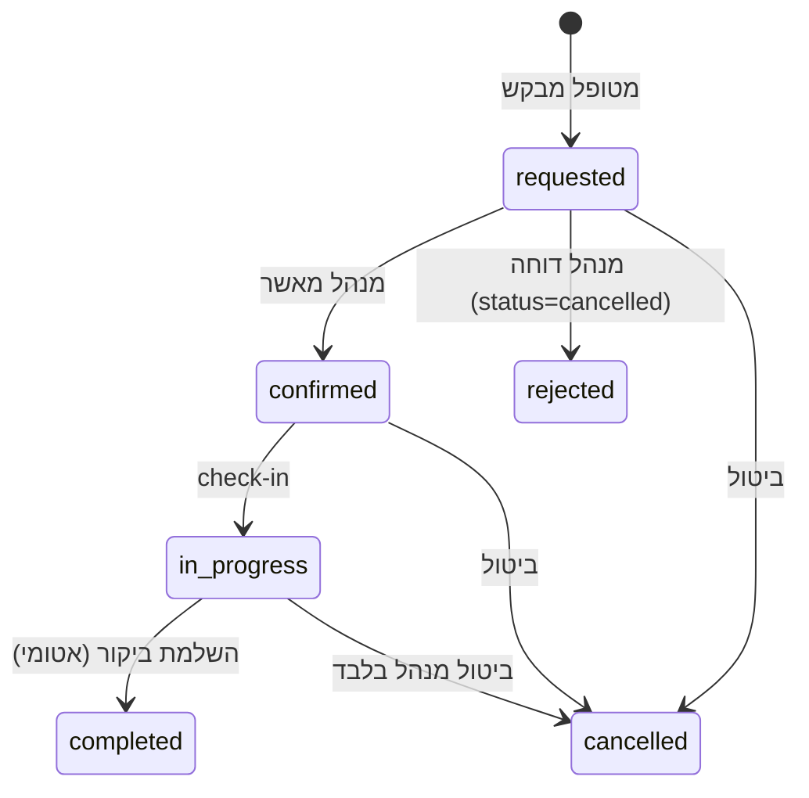

# אפיון המערכת — Home Care CRM

> **אפיון בסיס שנרכז כעת למערכת קיימת.** המסמך נכתב אחרי הפיתוח, על סמך הקוד שב-`main`, מסמכי הפרויקט והחלטות הבעלים. **הפיתוח לא נעשה לפיו, ואין לטעון שכך נעשה.** הוא מגדיר מכאן והלאה את ההתנהגות הנדרשת, את קריטריוני הקבלה, ואת מה שמומש, נבדק והופעל בפועל.
> **נכון ל:** 2026-11-05 · **בסיס:** `main` @ `8afecfc` · **בעלים:** מנהל המוצר (הפרויקט משמש גם כמוצר מסחרי וגם כפרויקט גמר).
> המסמך **אינו בוחר מדיניות עסקית או קלינית חדשה**. מה שלא הוכרע מופיע בסעיף [החלטות פתוחות](#11-החלטות-פתוחות). הוא לא תחליף למסמכים הטכניים; הוא מפנה אליהם.

**תוכן:** [1 מטרה](#1-מטרת-המוצר) · [2 היקף](#2-היקף-המוצר) · [3 תפקידים ותהליכים](#3-תפקידי-משתמשים-ותהליכי-עבודה) · [4 מוסכמות](#4-מוסכמות-המסמך) · [5 דרישות פונקציונליות](#5-דרישות-פונקציונליות) · [6 דרישות לא-פונקציונליות](#6-דרישות-לא-פונקציונליות) · [7 הרשאות](#7-הרשאות) · [8 מצבי ביקור](#8-מצבי-ביקור-ומעברים) · [9 רפואי, אופליין, סיכון ו-AI](#9-תיעוד-רפואי-אופליין-סנכרון-וסיכון--ai) · [10 קבלה ועקיבות](#10-קריטריוני-קבלה-ועקיבות) · [11 החלטות פתוחות](#11-החלטות-פתוחות) · [12 סתירות](#12-סתירות-ופערים-שנמצאו) · [13 מגבלות](#13-מגבלות) · [14 תחזוקה](#14-תחזוקת-האפיון)

## 1. מטרת המוצר
**מטרה עיקרית:** להפעיל את עסק ביקורי הבית של הבעלים. המערכת מחליפה תיאום טלפוני ונייר בתהליך אחד: מטופל מבקש שירות, מנהל מאשר ומשבץ, איש צוות מבצע ומתעד, והמערכת מסמנת מדדים מדאיגים לפי כללים שקופים.

**מטרה משנית:** אפשרות להתאים את המערכת בעתיד לעסקים נוספים. כיום קיימים רק **נקודות הגדרה** (סוגי שירות מוצעים, תפקידים זכאים, אזור זמן, מרווח נסיעה; ר' `NFR-ADP-01`). המערכת היא **מופע אחד לעסק אחד** ואין בה ריבוי עסקים (multi-tenant). אסטרטגיית ההתאמה לא הוכרעה ([O-11](#11-החלטות-פתוחות)).

**מה המערכת אינה:** מכשיר רפואי, כלי אבחון או מערכת התראה לחירום. מדד הסיכון הוא תמיכה בהחלטה בלבד. אין מודל למידת מכונה מאומן.

## 2. היקף המוצר
**בהיקף (קיים ב-`main` או מוגדר כדרישה בסעיפים 5–9):**
- בקשת ביקור ללא הרשמה, אישור ושיבוץ ע"י מנהל, ביצוע ותיעוד ע"י צוות (גם בלי קליטה), תיק מטופל, התראות, הערכת סיכון לפי כללים, תחזיות מגמה וקיבולת.
- ממשק לשלושה תפקידים: מטופל, איש צוות (כיום אחים ואחיות), מנהל.

**מחוץ להיקף כרגע (לא נבנה ולא הוחלט לבנות):**
- ריבוי עסקים (multi-tenant), חיוב ותשלומים, מחיר ואזור שירות, אינטגרציה עם מערכות חיצוניות (קופות חולים, מעבדות).
- התראות חיצוניות (אימייל, SMS, טלפון), עדכונים בזמן אמת, מעקב GPS.
- מודל למידת מכונה מאומן ומאומת קלינית; אבחון.
- הפעלה ייצורית עם מטופלים אמיתיים: אירוח עם HTTPS, מדיניות פרטיות והסכמה, בדיקת חדירות, סקירה משפטית (ר' [O-03](#11-החלטות-פתוחות), [O-10](#11-החלטות-פתוחות)).
- תפקידי משתמש מעבר למטופל, צוות ומנהל (למשל בן משפחה, הרשאות מדורגות).

## 3. תפקידי משתמשים ותהליכי עבודה
| תפקיד | זהות | מה יכול לעשות (בקצרה) |
|---|---|---|
| **מטופל** | סשן אנונימי בדפדפן (אופציונלי: אימייל וסיסמה; SMS בנוי וכבוי) | מבקש ביקור, רואה ומבטל את ההזמנות שלו |
| **איש צוות** | כניסה אישית (`medical_staff.auth_user_id`); כיום אחים ואחיות | רואה מטופלים משויכים, מתחיל ביקור, מתעד, רואה התראות |
| **מנהל** | `app_metadata.is_admin = true` | מאשר, דוחה, משבץ, מבטל, מנהל צוות, רואה כל התיקים, יכול לפעול בשם הצוות |
| **מערכת** | backend עם ה-JWT של הקורא; Edge Function עם service role | אוכפת כללים; ה-backend אינו משתמש ב-service role |

**התהליך העסקי המרכזי:**
1. **מטופל מבקש שירות:** בוחר שירות, כתובת, יום ושעה פנויה, ומזין שם, ת"ז וטלפון בשלב האחרון. נוצרת בקשה במצב "התבקש", עם מספר הזמנה.
2. **מנהל מאשר ומשבץ:** מאשר או דוחה. דחייה משחררת את המשבצת. אפשר לשבץ מחדש לאיש צוות מתאים ופנוי.
3. **צוות מבצע ומתעד:** מתחיל ביקור (שעת שרת), ממלא דוח (מדדים, הליכים, סיכום, חתימה), ושומר. ההשלמה והערכת הסיכון נעשות בשרת, והתראה נוצרת לפי הכללים.
4. **מנהל ומטופל רואים תוצאה:** המנהל רואה תיק, סיכון והתראות; המטופל רואה את מצב ההזמנה.

פירוט זרימות: [`docs/HOW_IT_WORKS.md`](HOW_IT_WORKS.md).

## 4. מוסכמות המסמך
**מזהים קבועים.** דרישה מזוהה `FR-<תחום>-<מספר>` (פונקציונלית) או `NFR-<תחום>-<מספר>` (לא-פונקציונלית). מזהה אינו משתנה ואינו נעשה בו שימוש חוזר גם אם הדרישה בוטלה (היא מסומנת "בוטלה"). החלטות פתוחות: `O-nn`; סתירות: `C-nn`.

**סטטוס.** לכל דרישה מצוין השלב הגבוה ביותר שהושג, עם הסתייגות כשצריך:
| סטטוס | משמעות |
|---|---|
| **מתוכננת** | לא ב-`main`: PR פתוח, הצעת SQL שלא הוחלה, או החלטה שטרם מומשה |
| **ממומשת** | הקוד ב-`main`, ללא בדיקה אוטומטית ייעודית |
| **נבדקה** | הקוד ב-`main` ויש בדיקות אוטומטיות שעוברות (הפניה בעמודת הבדיקות). ההיקף מצוין: בדיקות עם נתונים מדומים, או Postgres חד-פעמי |
| **הופעלה** | פועלת בסביבה מוגדרת. **הסביבה היחידה** היא פרויקט Supabase החי עם נתונים סינתטיים, רק לרכיבי מסד הנתונים שהוחלו (המיגרציות המקוריות ו-`001`-`007`, 2026-10-15). שירות ה-backend ושירות התחזית **לא מאורחים**, ולכן אף דרישה לא "הופעלה" בהם |

**מקורות הראיה.** קוד ב-`main`; מסמכי הפרויקט (`docs/DATABASE.md`, `supabase/proposed/APPLIED.md`); בדיקות. מצב המסד החי נלקח מהמסמכים (נבדק בקריאה בלבד ב-2026-10-31) ולא נבדק מחדש בעת כתיבת המסמך. `docs/REVIEW.md` מציין הרצה ידנית אחת של מחזור הזמנה מול המסד החי ב-2026-10-15; היא לא נשמרה כבדיקה ולא נחשבת כאן ראיה.

**מבנה הטבלאות.** בכל תחום שתי טבלאות באותו סדר: טבלת דרישות (דרישה, קריטריון קבלה, סטטוס) וטבלת עקיבות (מימוש ובדיקות) לאותם מזהים.

**הפניות לבדיקות.** `קובץ::שם_בדיקה` מצביע על פונקציית בדיקה קיימת. קובץ בלבד מצביע על קובץ בדיקות כולו (שמות הבדיקות בעברית). הפניות ל-PR פתוחים מופיעות כטקסט בלבד, כי הקבצים אינם ב-`main`.

## 5. דרישות פונקציונליות
### 5.1 הזמנת ביקור (מטופל) — `FR-BK`
| ID&nbsp;&nbsp;&nbsp;&nbsp;&nbsp;&nbsp;&nbsp;&nbsp;&nbsp; | דרישה | קריטריון קבלה | סטטוס |
|---|---|---|---|
| `FR-BK-01` | מטופל מזמין בלי הרשמה; פרטים אישיים רק בשלב האחרון | מטופל חדש משלים הזמנה בלי סיסמה; נוצר סשן אנונימי; מוצג מספר הזמנה | נבדקה (מדומה) |
| `FR-BK-02` | הבקשה נוצרת "התבקש וממתין לאישור"; זהות המטופל נלקחת מה-JWT ומזהים בגוף הבקשה מתעלמים; בכתיבה ישירה ה-DB מכריח `requested` | בקשה עם `patient_id`/`staff_id` מזויפים נשמרת על הקורא; מטופל לא יכול לאשר לעצמו | הופעלה (טריגר DB, `005`) |
| `FR-BK-03` | רק סוגי ביקור מוצעים. ברירת מחדל: בדיקה כללית, טיפול בפצע, בדיקת דם, מתן תרופות, אחר | סוג שאינו ברשימה נדחה 400 `purpose_not_offered`; ההצעה בממשק נקבעת בהגדרות | נבדקה |
| `FR-BK-04` | כתובת ביקור חובה (3-300 תווים); הערות עד 1000 | בקשה בלי כתובת נדחית 422 | נבדקה |
| `FR-BK-05` | בקשה חוזרת עם אותו `Idempotency-Key` מחזירה את אותה הזמנה, בלי כפילות; המפתח נפרד לכל מטופל | שליחה כפולה = הזמנה אחת; אחרי איבוד תשובה נשלח אותו מפתח | נבדקה; הופעלה (אינדקס DB) |
| `FR-BK-06` | זמינות מחושבת בשרת: משבצות לפי לוח שבועי של איש הצוות; **מרווח נסיעה של 30 דקות** בין כתובות שונות; כתובת זהה רצופה מותרת; כתובת לא ידועה נחשבת שונה; חפיפה תמיד חסומה; הזמנה מבוטלת לא נספרת | משבצת בתוך 30 דקות מביקור בכתובת אחרת לא מוצעת; בגבול 30 מותרת | נבדקה |
| `FR-BK-07` | כפל הזמנה נמנע ב-API (409 `slot_taken`) וב-DB (אינדקס ייחודי וטריגר מרווח), גם אם עוקפים את ה-API | שתי בקשות לאותה משבצת: אחת מצליחה; הודעה בעברית; בכתיבה ישירה ה-DB דוחה | נבדקה; הופעלה (`005`, בהכנסה) |
| `FR-BK-08` | אותן בדיקות חפיפה ומרווח גם בעדכון הזמנה קיימת (שינוי מועד, כתובת, איש צוות) | עדכון שיוצר חפיפה או הפרת מרווח נדחה ב-DB, כולל בהתחרות מקבילה | מתוכננת (נבדקה ב-DB חד-פעמי; לא הוחלה) |
| `FR-BK-09` | שיבוץ אוטומטי דטרמיניסטי כשלא נבחר איש צוות: פנוי ומתאים; עדיפות לעומס יומי נמוך; קרבה כשיש קואורדינטות; אחרת מזהה נמוך | אותו מצב נותן אותו שיבוץ בכל הרצה; איש צוות תפוס לא נבחר | נבדקה (קרבה: ללא geocoder ברירת מחדל) |
| `FR-BK-10` | רק תפקידים זכאים (`ELIGIBLE_ROLES`, ברירת מחדל: אחים/אחיות) ואנשי צוות פעילים ניתנים להזמנה | איש צוות שאינו זכאי לא מוצע ולא ניתן לבחירה; מושבת לא מוצע | נבדקה. חסימה גם ב-DB: ר' FR-MR-09 |
| `FR-BK-11` | הזמנה רק ליום עבודה ובשעה על רשת המשבצות של איש הצוות | בקשה מחוץ ליום עבודה או לרשת נדחית | נבדקה |
| `FR-BK-12` | מטופל מבטל הזמנה משלו עד תחילת הביקור; הזמנה של אחר נראית כ"לא נמצאה" (בלי דליפת קיום); ביקור שהושלם לא ניתן לביטול; ביטול חוזר אינו שגיאה | לפי הבדיקות; משבצת משתחררת | נבדקה |
| `FR-BK-13` | המטופל רואה מצב אחד: התבקש, אושר, בביצוע, הושלם, בוטל, לא אושר | "התבקש" לא מוצג כ"אושר"; סדר תצוגה לפי `display_state` | נבדקה |
| `FR-BK-14` | "ההזמנות שלי" והזמנה חוזרת עם אותו איש צוות ושירות | הזמנה חוזרת מעבירה לדף ההזמנה עם אותו איש צוות ומטרה | נבדקה (מדומה) |
| `FR-BK-15` | שמירת היסטוריה בחשבון אימייל וסיסמה (אופציונלי); כניסה ממכשיר שני. SMS בנוי וכבוי (`SMS_LOGIN_ENABLED=false`) | שדרוג אורח שומר הזמנות; עם SMS כבוי אין בורר טלפון | נבדקה (מדומה). SMS: לא הופעל (אין ספק) |
| `FR-BK-16` | כשל ב-backend או ברשת: הודעה ברורה, ולא נוצרת או מוצגת הזמנה | `BACKEND_URL` ריק, backend כבוי או פסק זמן: אין אישור ואין הזמנה | נבדקה (מדומה) |
| `FR-BK-17` | דפי המטופל בעברית, אנגלית וערבית | החלפת שפה משנה טקסטים ותוויות סוגי ביקור | ממומשת |
| `FR-BK-18` | המנהל יכול להשהות שירות (למשל בדיקות דם) לטווח תאריכים או עד לחידוש, עם הודעה למטופל; ההזמנות הקיימות לא נפגעות; האכיפה גם ב-backend וב-DB | שירות מושהה לא ניתן לבחירה בתאריכים המושהים; בקשה ישירה נדחית 409 | מתוכננת |

<b>עקיבות למימוש ולבדיקות</b> (הפניות קובץ::בדיקה נבדקות אוטומטית)

| ID&nbsp;&nbsp;&nbsp;&nbsp;&nbsp;&nbsp;&nbsp;&nbsp;&nbsp; | מימוש | בדיקות |
|---|---|---|
| `FR-BK-01` | `public/booking.html` `public/app.js` `backend/app/main.py` | `tests/e2e/backend-booking.spec.js` `tests/e2e/patient-account.spec.js` `backend/tests/test_api.py::test_guest_can_request_starts_requested` |
| `FR-BK-02` | `backend/app/service.py`, טריגר `bookings_guard_insert` (`005`) | `backend/tests/test_api.py::test_spoofed_ids_ignored` `backend/tests/test_api.py::test_spoofed_staff_identity_in_body_ignored` `backend/tests_db/test_db_guards.py::test_patient_insert_is_forced_to_requested` |
| `FR-BK-03` | `backend/app/config.py` (`OFFERED_PURPOSES`), `public/config.js` (`SERVICE_CONFIG`) | `backend/tests/test_api.py::test_purpose_not_offered` `tests/e2e/staff-convenience.spec.js` |
| `FR-BK-04` | `backend/app/models.py` | `backend/tests/test_api.py::test_address_required` |
| `FR-BK-05` | אינדקס ייחודי `bookings_patient_idempotency_key_uidx`; `backend/app/service.py` | `backend/tests/test_api.py::test_idempotency_same_key_same_booking` `backend/tests/test_api.py::test_idempotency_scoped_per_patient` `tests/e2e/backend-booking.spec.js` |
| `FR-BK-06` | `backend/app/scheduling.py` `GET /availability` | `backend/tests/test_scheduling.py` `backend/tests/test_api.py::test_availability_buffer_applies_to_different_address` `tests/e2e/booking-taken-slots.spec.js` |
| `FR-BK-07` | `backend/app/service.py`, טריגרים `005` | `backend/tests/test_api.py::test_double_booking_409_hebrew` `backend/tests/test_api.py::test_db_unique_violation_maps_to_409` `backend/tests_db/test_db_guards.py::test_double_booking_same_slot_is_blocked` `backend/tests_db/test_db_guards.py::test_travel_buffer_enforced_in_db` |
| `FR-BK-08` | הצעה `010_booking_update_conflict_guard.sql` | `backend/tests_db/test_booking_update_conflicts.py` |
| `FR-BK-09` | `backend/app/scheduling.py` (`rank_key`), `backend/app/service.py` | `backend/tests/test_api.py::test_auto_assignment_deterministic_lowest_id` `backend/tests/test_api.py::test_auto_assignment_prefers_lower_load` `backend/tests/test_api.py::test_auto_assignment_skips_busy_staff` `backend/tests/test_api.py::test_auto_assignment_proximity_when_coords` |
| `FR-BK-10` | `backend/app/config.py` `backend/app/service.py` | `backend/tests/test_api.py::test_non_nurse_staff_not_eligible` `tests/e2e/staff-convenience.spec.js` `tests/e2e/staff-deactivation.spec.js` |
| `FR-BK-11` | `backend/app/scheduling.py` | `backend/tests/test_api.py::test_non_working_day_rejected` `backend/tests/test_scheduling.py::test_working_weekday_and_hours` `backend/tests/test_scheduling.py::test_valid_slot_grid` |
| `FR-BK-12` | `backend/app/state.py` (`cancel_decision`), `backend/app/service.py` | `backend/tests/test_api.py::test_patient_cancels_own_requested_and_frees_slot` `backend/tests/test_api.py::test_other_patient_cannot_cancel_404_and_nothing_changes` `backend/tests/test_api.py::test_patient_cannot_cancel_after_check_in_409` `backend/tests/test_api.py::test_cancel_idempotent` `backend/tests/test_state.py::test_cancel_decision_rules` |
| `FR-BK-13` | `backend/app/state.py` (`display_state`) | `backend/tests/test_state.py::test_display_state` `tests/e2e/backend-booking.spec.js` |
| `FR-BK-14` | `public/my-bookings.html` | `tests/e2e/staff-convenience.spec.js` |
| `FR-BK-15` | `public/i18n.js` `public/my-bookings.html` `public/config.js` | `tests/e2e/patient-account.spec.js` |
| `FR-BK-16` | `public/app.js` (`backendFetch`) | `tests/e2e/backend-booking.spec.js` |
| `FR-BK-17` | `public/i18n.js` | — |
| `FR-BK-18` | PR #35 (לא ממוזג); הצעה `021` | בדיקות ב-PR #35 |

### 5.2 מנהל — `FR-AD`
| ID&nbsp;&nbsp;&nbsp;&nbsp;&nbsp;&nbsp;&nbsp;&nbsp;&nbsp; | דרישה | קריטריון קבלה | סטטוס |
|---|---|---|---|
| `FR-AD-01` | אישור ודחייה של בקשה. אישור רק להזמנה פעילה שמצבה "התבקש"; דחייה מבטלת ומשחררת את המשבצת. מטופל לא יכול לאשר לעצמו | אישור חוזר 409; אחרי דחייה המשבצת פנויה | נבדקה; הופעלה (טריגר DB, `005`) |
| `FR-AD-02` | שיבוץ מחדש רק להזמנה פעילה שלא נדחתה, לאיש צוות זכאי ופנוי, עם בדיקת חפיפה ומרווח | שיבוץ לתפוס נדחה; הפסד בתחרות מדווח כ-409 | נבדקה |
| `FR-AD-03` | מנהל מבטל כל הזמנה שלא הושלמה, גם אחרי תחילת ביקור | ביטול הזמנה שהושלמה: 409; ביטול חוזר: ללא שגיאה | נבדקה |
| `FR-AD-04` | נתיבי `/admin/*` למנהל בלבד. מנהל מוגדר רק כש-`is_admin` הוא בוליאני `true` | משתמש שאינו מנהל מקבל 403 | נבדקה |
| `FR-AD-05` | תור עבודה: בקשות חדשות מוצגות ראשונות ומסומנות; "מי דורש תשומת לב" לפי סיכון והתראות; סיכון אדום ישן אינו נעלם אלא מסומן "מיושן" | לפי מקרי הבדיקה | נבדקה (מדומה) |
| `FR-AD-06` | ניהול צוות: הוספה, עריכה, הפעלה והשבתה. יצירת כניסה לאיש צוות בהזמנה דרך Edge Function | איש צוות מושבת לא מקבל שיבוצים חדשים וההיסטוריה נשמרת | נבדקה (מדומה). חסימת מחיקה ב-DB: FR-MR-09 |
| `FR-AD-07` | מנהל יכול להתחיל ביקור ולהשלים אותו בשם איש הצוות המשובץ; הדוח נשאר משויך לשיבוץ | check-in והשלמה ע"י מנהל מצליחים עם שעת שרת | נבדקה |
| `FR-AD-08` | תיק מטופל מלא לכל מטופל עם חיפוש | תיק נטען לפי חיפוש; החלפת מטופל לא מציגה נתוני קודם (FR-RK-08) | נבדקה (מדומה) |
| `FR-AD-09` | תחזית קיבולת לחודש הבא | הערכה מוצגת לפי פרמטרי הקלט | ממומשת |
| `FR-AD-10` | תחזית מגמה לכל מטופל; הודעה כשאין מספיק נתונים או כשהשירות לא זמין; תוצאה של מטופל אחר לא מוצגת | לפי בדיקות הכפתור | נבדקה (מדומה) |
| `FR-AD-11` | ארכוב מטופל בלי מחיקה והוצאת תיק משפטי מלא עם רישום ביומן גישה ובסיס הבקשה | הוצאה רושמת יומן; ארכוב משאיר את ההיסטוריה קריאה | נבדקה. **לא הופעלה** (`013` לא הוחלה; הקליינט קורא לפונקציה שלא קיימת במסד החי) |
| `FR-AD-12` | התראות: הצגה, אישור קבלה, ללא כפילות של אותו סוג פתוח | אישור קבלה נרשם בשרת | נבדקה; הופעלה (`006`) |

<b>עקיבות למימוש ולבדיקות</b> (הפניות קובץ::בדיקה נבדקות אוטומטית)

| ID&nbsp;&nbsp;&nbsp;&nbsp;&nbsp;&nbsp;&nbsp;&nbsp;&nbsp; | מימוש | בדיקות |
|---|---|---|
| `FR-AD-01` | `backend/app/service.py` `public/js/admin/work-queue.js` | `backend/tests/test_api.py::test_approve_then_reapprove_409` `backend/tests/test_api.py::test_reject_frees_slot` `backend/tests_db/test_db_guards.py::test_admin_can_approve_and_reject` `tests/e2e/backend-booking.spec.js` |
| `FR-AD-02` | `backend/app/service.py` | `backend/tests/test_api.py::test_reassign_rechecks_conflict` `backend/tests/test_api.py::test_reassign_rechecks_buffer` `backend/tests/test_api.py::test_reassign_lost_race_is_reported_as_a_clear_conflict` `tests/e2e/backend-booking.spec.js` |
| `FR-AD-03` | `backend/app/state.py` | `backend/tests/test_api.py::test_admin_cancel_ok_incl_checked_in_and_idempotent` `backend/tests/test_api.py::test_cancel_completed_409` |
| `FR-AD-04` | `backend/app/auth.py` `backend/app/main.py` | `backend/tests/test_api.py::test_admin_routes_forbidden_for_non_admin` `backend/tests/test_auth.py::test_is_admin_must_be_true_boolean` |
| `FR-AD-05` | `public/js/admin/work-queue.js` `public/admin.html` | `tests/e2e/backend-booking.spec.js` `tests/e2e/my-work-pagination.spec.js` `tests/e2e/admin-lifecycle.spec.js` |
| `FR-AD-06` | `public/js/admin/staff.js` `supabase/functions/create-staff-login` | `tests/e2e/staff-deactivation.spec.js` |
| `FR-AD-07` | `backend/app/service.py` (`*_admin`) | `backend/tests/test_api.py::test_complete_by_admin_ok_keeps_booking_staff` `backend/tests/test_api.py::test_checkin_by_admin_ok_server_time_and_idempotent` `tests/e2e/admin-lifecycle.spec.js` |
| `FR-AD-08` | `public/js/admin/patient-record.js` `public/js/admin/patients.js` | `tests/e2e/cross-patient-isolation.spec.js` `tests/e2e/admin-lifecycle.spec.js` |
| `FR-AD-09` | `public/js/admin/capacity.js` `predictive-service/main.py` (`/predict/capacity`) | — |
| `FR-AD-10` | `public/admin.html` `predictive-service/timeseries.py` | `tests/e2e/trend-forecast.spec.js` |
| `FR-AD-11` | `public/js/admin/patient-record.js`; הצעה `013_patient_archive_and_record_export.sql` | `backend/tests_db/test_patient_archive_export.py` `tests/e2e/admin-lifecycle.spec.js` `tests/unit/record-export.test.js` |
| `FR-AD-12` | `public/admin.html` `backend/app/risk.py` | `backend/tests_db/test_risk_and_alerts.py` `backend/tests/test_risk.py::test_open_alert_of_same_type_is_not_duplicated` |

### 5.3 איש צוות — `FR-ST`
| ID&nbsp;&nbsp;&nbsp;&nbsp;&nbsp;&nbsp;&nbsp;&nbsp;&nbsp; | דרישה | קריטריון קבלה | סטטוס |
|---|---|---|---|
| `FR-ST-01` | איש צוות רואה רק מטופלים משויכים אליו | משויך אחר או מטופל אחר מקבל 403 או אינו רואה | נבדקה; הופעלה (RLS). **פער:** [C-05](#12-סתירות-ופערים-שנמצאו) |
| `FR-ST-02` | כרטיס "הביקור הבא": כתובת, אלרגיות, ניווט והתקשרות; בלי נתון הכפתור מושבת עם הסבר | `href` נכון; נעדר כתובת או טלפון: מושבת | נבדקה (מדומה) |
| `FR-ST-03` | תחילת ביקור (check-in): שעת שרת בלבד, אידמפוטנטי, רק להזמנה מאושרת ופעילה, רק למשובץ או מנהל | שעה לא מהלקוח; חוזר ללא שינוי; לא מאושרת: 409; משובץ אחר: 403 | נבדקה; הופעלה (`002`) |
| `FR-ST-04` | השלמת ביקור אטומית: דוח ו-`completed` יחד או בכלל לא; לא פעמיים, לא להזמנה שלא אושרה או שבוטלה | כשל באמצע לא משאיר מצב חלקי | נבדקה; הופעלה (`003`) |
| `FR-ST-05` | דוח ביקור: שישה מדדים, חמישה הליכים, סיכום טיפול (חובה, עד 5000 תווים) וחתימה. הטווחים הנוכחיים נאכפים בממשק, ב-backend וב-DB ואינם הוכרעו קלינית ([O-02](#11-החלטות-פתוחות)) | ערך מחוץ לטווח נדחה 422; ערכי גבול מתקבלים | נבדקה |
| `FR-ST-06` | תוצאה קלינית אחרי 8 שעות על דוח קיים: רק למשובץ של אותו דוח או למנהל; ניתן גם אחרי נעילה | משובץ אחר: 403; גוף הבקשה לא יכול לשנות עמודות אחרות | נבדקה |
| `FR-ST-07` | "העבודה שלי": ביקורי היום והיסטוריה כולל ביקורים שאינם מתוזמנים; בהזמנה שלא אושרה אין כפתור התחלה | הזמנה ממתינה מסומנת; נדחתה לא מוצגת | נבדקה (מדומה). ביקור שעבר מועדו ולא התחיל: [O-07](#11-החלטות-פתוחות) |
| `FR-ST-08` | איש צוות מושבת לא מקבל שיבוצים חדשים; בכתיבה ישירה נחסם ב-DB | ממשק ו-backend: לפי FR-BK-10; DB: הצעת `009` | נבדקה (backend); DB: מתוכננת (`009` לא הוחלה) |

<b>עקיבות למימוש ולבדיקות</b> (הפניות קובץ::בדיקה נבדקות אוטומטית)

| ID&nbsp;&nbsp;&nbsp;&nbsp;&nbsp;&nbsp;&nbsp;&nbsp;&nbsp; | מימוש | בדיקות |
|---|---|---|
| `FR-ST-01` | RLS: `is_my_patient` `current_staff_id` | `backend/tests_db/test_risk_status_view.py::test_staff_sees_only_assigned_patient_status_through_rls` `backend/tests_db/test_visit_report_amendments.py::test_visibility_staff_assigned_patient_own_and_others_none` `tests/e2e/mobile-journey.spec.js` |
| `FR-ST-02` | `public/employee.html` | `tests/e2e/staff-field-actions.spec.js` |
| `FR-ST-03` | `backend/app/service.py`; פונקציית DB `check_in_visit` (`002`) | `backend/tests/test_api.py::test_checkin_server_time_and_idempotent` `backend/tests/test_api.py::test_checkin_other_staff_403_non_staff_403` `backend/tests/test_api.py::test_checkin_unapproved_409` `backend/tests_db/test_db_guards.py::test_check_in_rejected_for_non_assigned_user` |
| `FR-ST-04` | `backend/app/service.py`; פונקציית DB `complete_visit` (`003`) | `backend/tests/test_api.py::test_complete_atomic_call` `backend/tests/test_api.py::test_complete_twice_409` `backend/tests/test_api.py::test_complete_unapproved_409` `backend/tests_db/test_db_guards.py::test_complete_rejects_unconfirmed_and_bad_vitals_atomically` |
| `FR-ST-05` | `backend/app/models.py` (`VisitReportIn`), `public/employee.html` | `backend/tests/test_api.py::test_vitals_out_of_range_422` `backend/tests/test_api.py::test_vitals_boundaries_accepted` `tests/unit/visit-report-shared.test.js` |
| `FR-ST-06` | `backend/app/service.py` (`set_clinical_outcome`) | `backend/tests/test_api.py::test_outcome_assigned_staff_ok` `backend/tests/test_api.py::test_outcome_other_staff_and_patient_403` `backend/tests/test_api.py::test_outcome_body_cannot_smuggle_other_columns` |
| `FR-ST-07` | `public/employee.html` | `tests/e2e/staff-field-actions.spec.js` `tests/e2e/overhaul-regressions.spec.js` `tests/e2e/my-work-pagination.spec.js` |
| `FR-ST-08` | `backend/app/supabase_repo.py` (סינון `is_active`); הצעה `009_staff_deactivate_not_delete.sql` | `tests/e2e/staff-deactivation.spec.js` `backend/tests_db/test_staff_deactivation.py` |

## 6. דרישות לא-פונקציונליות
| ID&nbsp;&nbsp;&nbsp;&nbsp;&nbsp;&nbsp;&nbsp;&nbsp;&nbsp; | דרישה | קריטריון קבלה | סטטוס |
|---|---|---|---|
| `NFR-SEC-01` | RLS מופעל על כל טבלה; ל-`anon` אין הרשאות על טבלאות האפליקציה; מטופל רואה את שלו, צוות את המשויכים, מנהל הכול | בדיקת post-flight: אין הרשאת `anon`; RLS על כל טבלה | נבדקה; הופעלה |
| `NFR-SEC-02` | הדפדפן מחזיק רק מפתח ציבורי. מפתח service role לעולם לא באפליקציה; רק ב-Edge Function בצד השרת | חיפוש בקוד: אין service role ב-`public/` ובקריאות ה-backend | נבדקה |
| `NFR-SEC-03` | ה-backend מאמת JWT (HS256 ו-ES256 מ-JWKS), תוקף וקהל; אלגוריתם לא תואם או סוד חסר נדחים (נכשל סגור) | כל המקרים השליליים נדחים | נבדקה |
| `NFR-SEC-04` | ה-backend פועל עם ה-JWT של הקורא, כך ש-RLS נשארת בתוקף | כל קריאת PostgREST נושאת את ה-JWT של הקורא | נבדקה |
| `NFR-SEC-05` | כתובות וקואורדינטות של מטופל לא נחשפות למטופל אחר | חסימות זמינות מחזירות רק זמנים | נבדקה; הופעלה (`004`) |
| `NFR-SEC-06` | טקסט חופשי מוצג כטקסט ולא כ-HTML | שם וכתובת זדוניים לא מבוצעים | נבדקה (מדומה) |
| `NFR-SEC-07` | אין סודות ב-Git; סריקת היסטוריה ב-CI וב-hook מקומי | סריקת הסודות ב-CI עוברת | נבדקה |
| `NFR-SEC-08` | הקשחת הזדהות: CAPTCHA להזמנה אנונימית, MFA, הגנת סיסמאות מודלפות | — | מתוכננת ([O-09](#11-החלטות-פתוחות)) |
| `NFR-PRV-01` | מדיניות פרטיות, הסכמה מדעת ותקופת שמירה | מסמכים מאושרים משפטית | מתוכננת ([O-03](#11-החלטות-פתוחות)) |
| `NFR-REL-01` | כשל שירות חיצוני אינו יוצר נתון שגוי; הודעה ברורה ושום דבר לא נשמר | שירות החיזוי כבוי: 503 בעברית; backend כבוי: אין הזמנה | נבדקה |
| `NFR-REL-02` | פעולות מורכבות אטומיות: השלמת ביקור; הערכת סיכון עם התראה | כשל באמצע לא משאיר מצב חלקי | נבדקה; הופעלה |
| `NFR-AUD-01` | עקיבות: זהות כותב ושעה נקבעות בשרת; יומן שינויים על טבלאות רגישות | שדה כותב שנשלח מהלקוח נדרס | נבדקה; הופעלה (`007`) |
| `NFR-AVL-01` | אירוח זמין: backend ושירות החיזוי מאורחים עם HTTPS, ניטור וגיבוי. **לא הוגדרו יעדי זמינות (SLA)** | — | מתוכננת ([O-10](#11-החלטות-פתוחות)) |
| `NFR-PERF-01` | ביצועים: לא הוגדרו יעדים ולא נמדדו | — | לא מוגדרת |
| `NFR-USE-01` | ממשק מובייל ו-RTL: בלי גלישה אופקית ב-400px; יעדי מגע לפחות 44px | לפי בדיקות | נבדקה (מדומה) |
| `NFR-ACC-01` | נגישות | לפחות: ניווט במקלדת וקורא מסך על המסכים המרכזיים | ממומשת חלקית; לא נבדקה |
| `NFR-I18N-01` | דפי המטופל בשלוש שפות; ממשק הצוות והמנהל בעברית | — | ממומשת |
| `NFR-ADP-01` | התאמה לעסק אחר דרך הגדרות בלבד, ללא שינוי קוד, ברמה הקיימת: סוגי שירות מוצעים, תפקידים זכאים, אזור זמן, מרווח נסיעה, מגבלת טווח זמינות | שינוי ערך הגדרה משנה את ההתנהגות | ממומשת חלקית ([O-11](#11-החלטות-פתוחות)) |
| `NFR-TST-01` | בדיקות אוטומטיות ב-CI בכל push: יחידה, backend, מסד חד-פעמי, דפדפן מדומה, סריקת סודות, בדיקת תיעוד | ה-CI ירוק על `main` | נבדקה |
| `NFR-TST-02` | בדיקות המסד על Postgres 16 ו-18, עם נתונים סינתטיים | 95 בדיקות עוברות בשתיהן | נבדקה |
| `NFR-OPS-01` | שינוי מסד נתונים רק באישור הבעלים, אחד-אחד, אחרי גיבוי מאומת, עם בלוק שחזור | לכל הצעה בלוק שחזור שנבדק | נבדקה |
| `NFR-DOC-01` | כל שינוי משמעותי מעדכן את התיעוד, את הדרישה וקריטריוני הקבלה הרלוונטיים; בדוח הסיום מצוין מה עודכן | `python scripts/check_docs.py` עובר | נבדקה |
| `NFR-DAT-01` | נתונים סינתטיים בלבד; מצב הדגמה מציג באנר "מערכת הדגמה" | `DEMO_MODE` מציג את הבאנר | נבדקה |

<b>עקיבות למימוש ולבדיקות</b> (הפניות קובץ::בדיקה נבדקות אוטומטית)

| ID&nbsp;&nbsp;&nbsp;&nbsp;&nbsp;&nbsp;&nbsp;&nbsp;&nbsp; | מימוש / ראיה | בדיקות |
|---|---|---|
| `NFR-SEC-01` | `supabase/migrations/` `docs/DATABASE.md` | `backend/tests_db/test_staging_postflight.py` |
| `NFR-SEC-02` | `backend/app/supabase_repo.py` `supabase/functions/create-staff-login` | `backend/tests/test_supabase_repo.py::test_insert_uses_caller_jwt_and_path` |
| `NFR-SEC-03` | `backend/app/auth.py` | `backend/tests/test_auth.py` |
| `NFR-SEC-04` | `backend/app/supabase_repo.py` | `backend/tests/test_supabase_repo.py` |
| `NFR-SEC-05` | `backend/app/scheduling.py`; פונקציית DB `staff_busy_blocks` (`004`) | `backend/tests/test_privacy.py` `backend/tests_db/test_db_guards.py::test_staff_busy_blocks_never_reveals_other_patients_address` |
| `NFR-SEC-06` | `escapeHtml` ב-`public/app.js` | `tests/e2e/xss-escaping.spec.js` `tests/e2e/staff-field-actions.spec.js` |
| `NFR-SEC-07` | `.github/workflows/ci.yml` `.githooks/` `SECURITY.md` | CI: Secret scan |
| `NFR-SEC-08` | לא מומש | — |
| `NFR-PRV-01` | לא קיים. אין בתיעוד טענת עמידה בחוק או בתקן | — |
| `NFR-REL-01` | `backend/app/risk.py` `public/app.js` | `backend/tests/test_risk.py::test_predictive_down_503_hebrew_and_nothing_written` `tests/e2e/backend-booking.spec.js` |
| `NFR-REL-02` | פונקציות DB `003` `006` | `backend/tests/test_risk.py::test_persistence_failure_writes_neither` `backend/tests_db/test_risk_and_alerts.py` |
| `NFR-AUD-01` | טריגרי `007`; `audit_log` | `backend/tests_db/test_authorship.py` |
| `NFR-AVL-01` | כיום שניהם רצים מקומית ידנית; אין גיבוי פלטפורמה בתוכנית הנוכחית | — |
| `NFR-PERF-01` | — | — |
| `NFR-USE-01` | `public/styles.css` | `tests/e2e/mobile-journey.spec.js` `tests/e2e/staff-field-actions.spec.js` |
| `NFR-ACC-01` | נעשו תיקונים נקודתיים; **לא נבדקה** עם כלי נגישות או קורא מסך | — |
| `NFR-I18N-01` | `public/i18n.js` | — |
| `NFR-ADP-01` | `backend/app/config.py` `public/config.js`. לא קיימים: ריבוי עסקים, מיתוג, רשימת שירותים דינמית (רשימת סוגי הביקור היא אילוץ במסד) | `backend/tests/test_api.py::test_purpose_not_offered` |
| `NFR-TST-01` | `.github/workflows/ci.yml`. מחוץ ל-CI: `booking.spec.js` `visit-report.spec.js` (כותבות למסד חי; ידני בלבד); בדיקות הבידוד והתחזית | — |
| `NFR-TST-02` | `backend/tests_db/` `backend/scripts/verify_proposed_sql.py` | `backend/tests_db/test_staging_postflight.py` |
| `NFR-OPS-01` | `docs/STAGING_PLAN.md` `supabase/proposed/APPLIED.md` | `backend/tests_db/test_staging_postflight.py::test_rollback_blocks_work_in_reverse_order` |
| `NFR-DOC-01` | `CLAUDE.md` `scripts/check_docs.py` | CI: Documentation links and paths |
| `NFR-DAT-01` | `public/config.js` | `tests/e2e/demo-journey.spec.js` |

## 7. הרשאות
**מקורות האכיפה:** (1) RLS במסד הנתונים; (2) בדיקות ב-backend לפי זהות ה-JWT; (3) טריגרים ופונקציות DB. מטופל מזוהה לפי `auth.uid()`; מנהל לפי `app_metadata.is_admin = true` בלבד.

| פעולה | מטופל | איש צוות | מנהל | הערה |
|---|---|---|---|---|
| בקשת ביקור | כן (שלו) | — | — | `POST /bookings/request`; ה-DB מכריח `requested` |
| ביטול הזמנה | שלו, עד check-in | לא | כל הזמנה שלא הושלמה | הזמנה של אחר: 404 למטופל |
| אישור, דחייה, שיבוץ מחדש | לא | לא | כן | `/admin/*` |
| check-in | לא | המשובץ בלבד | כן (בשם המשובץ) | הזמנה מאושרת ופעילה בלבד |
| השלמת ביקור | לא | המשובץ בלבד | כן (בשם המשובץ) | אטומי |
| תוצאה קלינית 8 שעות | לא | המשובץ של הדוח | כן | |
| הערכת סיכון לדוח | לא | המשובץ | כן | HMAC מהשרת |
| קריאת תיק מטופל | שלו | מטופלים משויכים | כולם | ר' [C-05](#12-סתירות-ופערים-שנמצאו) |
| ניהול צוות, ארכוב מטופל, הוצאת תיק | לא | לא | כן | ארכוב והוצאה: `013` לא הוחלה |
| תיקון דוח שהושלם | לא | כיום: צוות משויך (הצעה `012`) | כיום: כן | **החלטה:** רק המחבר המקורי (`017`), לא הוחלה |

## 8. מצבי ביקור ומעברים
לכל ביקור שלושה ממדים בטבלת `bookings` (מקור האמת: `backend/app/state.py`):
- **`approval_status`:** `requested` ← `confirmed` או `rejected`.
- **`status`:** `scheduled` ← `completed` או `cancelled`.
- **`workflow_status`:** `unassigned`, `assigned`, `in_progress`.

*המצב המוצג למטופל נגזר מהשילוב (`display_state`); `en_route` אינו קיים כי אין מעקב GPS.*

| מעבר | מותר | תנאי | אחרת |
|---|---|---|---|
| `approval_status`: requested ← confirmed | כן | `status = scheduled` | 409 `illegal_transition` |
| `approval_status`: requested ← rejected | כן | יחד עם `status ← cancelled` (משחרר משבצת) | 409 |
| confirmed או rejected ← כל מצב אחר | **לא** | ביטול הזמנה מאושרת נעשה דרך `status` | 409 |
| `status`: scheduled ← completed | כן | `approval_status = confirmed`; דרך השלמה אטומית בלבד | 409 |
| `status`: scheduled ← cancelled | כן | מטופל: רק לפני check-in; מנהל: גם אחריו | 409 |
| `status`: completed או cancelled ← כל מצב | **לא** | ביטול הזמנה מבוטלת הוא no-op | 409 (ל-completed) |
| check-in | כן | `confirmed` ו-`scheduled`; חוזר: ללא שינוי | 409 |
| שיבוץ מחדש | כן | `scheduled`, לא `rejected`, איש צוות זכאי ופנוי | 409 / 400 |

**הערה:** טבלת `WORKFLOW_TRANSITIONS` ב-`backend/app/state.py` מגדירה את מעברי `workflow_status`, אך לא אימתתי שה-backend קורא לה ישירות. ההשפעה בפועל נקבעת בפונקציות ה-DB (check-in, שיבוץ). ראו [C-09](#12-סתירות-ופערים-שנמצאו). בדיקות המעברים: `backend/tests/test_state.py::test_allowed_transitions`, `backend/tests/test_state.py::test_illegal_transitions_409`.

## 9. תיעוד רפואי, אופליין, סנכרון וסיכון / AI
פירוט טכני: [`docs/DATABASE.md`](DATABASE.md), [`docs/RISK_ENGINE.md`](RISK_ENGINE.md), [`docs/SECURITY_ARCHITECTURE.md`](SECURITY_ARCHITECTURE.md).

### 9.1 תיעוד רפואי — `FR-MR`
| ID&nbsp;&nbsp;&nbsp;&nbsp;&nbsp;&nbsp;&nbsp;&nbsp;&nbsp; | דרישה | קריטריון קבלה | סטטוס |
|---|---|---|---|
| `FR-MR-01` | תיק מטופל: אלרגיות, רקע רפואי, הערות קליניות, יומן תרופות, תוכניות שירות, מסמכים, הודעות, היסטוריית מדדים עם שינוי מהמדידה הקודמת, ציר זמן | המדדים מוצגים זה לצד זה עם ההפרש | נבדקה (חלקית) |
| `FR-MR-02` | כותב הרשומה נקבע בשרת; הערות קליניות להוספה בלבד | ערך כותב מהלקוח נדרס | נבדקה; הופעלה (`007`) |
| `FR-MR-03` | יומן שינויים (`audit_log`) נכתב אוטומטית ע"י טריגר בטבלאות רגישות, ולא ישירות | שינוי רשומה יוצר שורת יומן | ממומשת; הופעלה |
| `FR-MR-04` | דוח שהושלם ננעל; הכנסת דוח רק להזמנה מאושרת עם מטופל ואיש צוות תואמים; זהות הדוח אינה ניתנת לשינוי | עדכון תוכן דוח שהושלם נדחה | מתוכננת (נבדקה ב-DB חד-פעמי; לא הוחלה) |
| `FR-MR-05` | תיקון בדיעבד לדוח שהושלם נשמר כרשומה חדשה; המקור נשמר והיסטוריה מציגה את שניהם | המקור לא משתנה; התיקון לא ניתן למחיקה | נבדקה. **לא הופעלה** |
| `FR-MR-06` | **החלטת בעלים:** לא מוחקים פיזית רשומה רפואית באפליקציה. "מחיקה" היא ארכוב (הפיך) או ביטול (בלתי הפיך), עם סיבה, ע"י המחבר | ניסיון מחיקה פיזית נחסם בכל תפקיד שאינו בעל ה-DB | מתוכננת. ב-`main` עדיין קיימים כפתורי מחיקה ([C-04](#12-סתירות-ופערים-שנמצאו)) |
| `FR-MR-07` | **החלטת בעלים:** רק המחבר המקורי מתקן את התיעוד שלו, כתיקון חדש; מנהל שמשלים ביקור הוא המחבר; דוחות ישנים בלי מחבר מזוהה אינם ניתנים לתיקון באפליקציה | מנהל שאינו המחבר נדחה | מתוכננת |
| `FR-MR-08` | **החלטת בעלים:** גישת צוות לתיק מתחילה בהזמנה (כולל "התבקש") ומוסרת בהזמנה שבוטלה או נדחתה; אחרי ביקור שהושלם הגישה נשמרת ללא הגבלת זמן | הזמנה מבוטלת או נדחית אינה נותנת גישה | מתוכננת |
| `FR-MR-09` | איש צוות שיש לו היסטוריה מושבת ולא נמחק; ההיסטוריה נשמרת ואיש לא יורש הרשאות | מחיקת איש צוות עם היסטוריה נחסמת | מתוכננת (נבדקה ב-DB חד-פעמי) |
| `FR-MR-10` | תקופת שמירת רשומות ועילות חשיפה | החלטה משפטית כתובה | מתוכננת ([O-03](#11-החלטות-פתוחות)) |

<b>עקיבות למימוש ולבדיקות</b> (הפניות קובץ::בדיקה נבדקות אוטומטית)

| ID&nbsp;&nbsp;&nbsp;&nbsp;&nbsp;&nbsp;&nbsp;&nbsp;&nbsp; | מימוש | בדיקות |
|---|---|---|
| `FR-MR-01` | `public/js/admin/patient-record.js` | `tests/unit/vitals-history.test.js` `tests/e2e/admin-lifecycle.spec.js` |
| `FR-MR-02` | טריגרי `007` | `backend/tests_db/test_authorship.py` |
| `FR-MR-03` | `supabase/migrations/` (טריגר `log_audit_change`) | — |
| `FR-MR-04` | הצעה `008_visit_report_integrity.sql` | `backend/tests_db/test_visit_report_integrity.py` |
| `FR-MR-05` | הצעה `012_visit_report_amendments.sql`; ממשק ב-`main` | `backend/tests_db/test_visit_report_amendments.py` `tests/e2e/admin-lifecycle.spec.js` |
| `FR-MR-06` | הצעות `015` `018` ושינוי ממשק (PR #30, PR #31) | בדיקות ב-PR #30 |
| `FR-MR-07` | הצעות `016` `017` `018` (PR #30) | בדיקות ב-PR #30 |
| `FR-MR-08` | הצעה `019` (PR #30) | בדיקות ב-PR #30 |
| `FR-MR-09` | הצעה `009_staff_deactivate_not_delete.sql` | `backend/tests_db/test_staff_deactivation.py` |
| `FR-MR-10` | לא קיים. המערכת לא מוחקת אוטומטית ואינה מצהירה על עמידה בחוק | — |

### 9.2 אופליין וסנכרון — `FR-OF`
| ID&nbsp;&nbsp;&nbsp;&nbsp;&nbsp;&nbsp;&nbsp;&nbsp;&nbsp; | דרישה | קריטריון קבלה | סטטוס |
|---|---|---|---|
| `FR-OF-01` | דוח ביקור ניתן לכתיבה בלי קליטה: טיוטה נשמרת מקומית לכל משתמש. "נשמר מקומית" מוצג רק אחרי שהשמירה הצליחה; כשל אחסון מציג שגיאה והטופס נשאר | כשל באחסון המקומי לא מציג "נשמר" | נבדקה |
| `FR-OF-02` | סנכרון כשהחיבור חוזר. טיוטה יורדת מהתור רק אחרי אישור שרת ולעולם לא נדרסת או נמחקת בלי אישור | כשל סנכרון משאיר את הטיוטה | נבדקה |
| `FR-OF-03` | בידוד בין משתמשים: החלפת חשבון במכשיר לא חושפת ולא דורסת טיוטות של אחר | טיוטות לפי מזהה משתמש | נבדקה |
| `FR-OF-04` | מסע מלא: בקשה, אישור, ביקור, השלמה אופליין, סנכרון, והמטופל רואה את התוצאה | המסע עובר בבדיקה | נבדקה (מדומה) |
| `FR-OF-05` | מעטפת האפליקציה במטמון (רשת תחילה); עדכון גרסה מתפשט למשתמשים. הזמנה עצמה דורשת חיבור | גרסה חדשה נטענת | נבדקה |
| `FR-OF-06` | שגיאת שרת או פסק זמן אחרי שליחה: הודעה "לא אושר ע"י השרת", תוכן נשמר, ניסיון חוזר בטוח, בלי מחיקה | טיוטה לא אובדת | מתוכננת |
| `FR-OF-07` | שמירה כפולה מאומתת (409 "אותו דוח") ממשיכה בבקשת הערכת סיכון | הערכה נשלחת או נשמרת לניסיון חוזר | מתוכננת |
| `FR-OF-08` | טיוטות אופליין מוצפנות במכשיר, בלי סיכון לאובדן מסמך שלא סונכרן | נדרשת תוכנית שחזור מפתח שהבעלים אישר | מתוכננת ([O-08](#11-החלטות-פתוחות)) |

<b>עקיבות למימוש ולבדיקות</b> (הפניות קובץ::בדיקה נבדקות אוטומטית)

| ID&nbsp;&nbsp;&nbsp;&nbsp;&nbsp;&nbsp;&nbsp;&nbsp;&nbsp; | מימוש | בדיקות |
|---|---|---|
| `FR-OF-01` | `public/app.js` (תור הטיוטות) | `tests/e2e/staff-field-actions.spec.js` `tests/unit/offline-queue.test.js` |
| `FR-OF-02` | `public/app.js` (`flushOfflineQueue`) | `tests/unit/offline-queue-reliability.test.js` `tests/unit/offline-queue.test.js` |
| `FR-OF-03` | `public/app.js` | `tests/unit/offline-queue-isolation.test.js` |
| `FR-OF-04` | — | `tests/e2e/mobile-journey.spec.js` |
| `FR-OF-05` | `public/service-worker.js` | `tests/e2e/sw-update.spec.js` |
| `FR-OF-06` | PR #33 (לא ממוזג) | בדיקות ב-PR #33 |
| `FR-OF-07` | PR #27 (לא ממוזג) | בדיקות ב-PR #27 |
| `FR-OF-08` | **לא קיים.** הטיוטות ב-`localStorage`, מופרדות לפי משתמש, **לא מוצפנות** | — |

### 9.3 הערכת סיכון — `FR-RK`
| ID&nbsp;&nbsp;&nbsp;&nbsp;&nbsp;&nbsp;&nbsp;&nbsp;&nbsp; | דרישה | קריטריון קבלה | סטטוס |
|---|---|---|---|
| `FR-RK-01` | רמת סיכון (ירוק, צהוב, אדום) לפי סיווג דטרמיניסטי של כל מדד והחמור מביניהם. **הספים כלליים ולא אומתו קלינית** | קלטים → אותה רמה בכל הרצה | נבדקה (חישוב); תוקף קליני לא נקבע ([O-01](#11-החלטות-פתוחות)) |
| `FR-RK-02` | ההערכה מחושבת בשרת ונחתמת ב-HMAC לפני שמירה; לקוח אינו יכול לזייף חיזוי או התראה | כתיבה בלי חתימה נדחית; הסוד חסר: נכשל סגור | נבדקה; הופעלה (`006`) |
| `FR-RK-03` | הערכה לדוח רק למשובץ או מנהל; אחר: 403 ושום דבר לא נכתב | — | נבדקה |
| `FR-RK-04` | שירות החיזוי כבוי: 503 בעברית ושום דבר לא נשמר; באנר קבוע בעמוד | — | נבדקה |
| `FR-RK-05` | אין נתונים: לא נכתבת הערכה | — | נבדקה |
| `FR-RK-06` | התראה אוטומטית ללא כפילות של אותו סוג פתוח; כשל בהתראה לא מאבד את ההערכה | — | נבדקה; הופעלה |
| `FR-RK-07` | סטטוס הסיכון הנוכחי נשאר גלוי אחרי 8 שעות ומסומן "מיושן" אחרי 24 שעות; אדום לא נעלם; דוח חדש שלא הוערך מסומן | — | נבדקה. **לא הופעלה** (`011` לא הוחלה) |
| `FR-RK-08` | בידוד בין מטופלים: תשובה מאוחרת של מטופל אחד לא מוצגת בתיק, בסיכון או בחיזוי של אחר; מטופל אחד אינו משפיע על חישוב לאחר | החלפות מהירות א׳, ב׳, א׳, ב׳ מציגות רק את האחרון | נבדקה (מדומה) |
| `FR-RK-09` | בסיס אישי, חריגים ותחזית מגמה בשיטות סטטיסטיות קלאסיות (רגרסיה ליניארית; ARIMA מ-8 מדידות); בהיסטוריה קצרה: "אין מספיק נתונים" | — | נבדקה (ממשק). פרמטרים לא אומתו קלינית |
| `FR-RK-10` | אין הצגת הסתברות למידת מכונה כמאומתת: מסווגי ה-ML מחזירים "אין מודל" כשאין artifact מאומן; LSTM הוא placeholder | — | ממומשת (כמתועד) |
| `FR-RK-11` | ניסוח הממשק של הסטטוס (למשל "מצב תקין" לירוק, "אין נתונים" כחשש נמוך) | החלטה קלינית כתובה | מתוכננת ([O-01](#11-החלטות-פתוחות)) |

<b>עקיבות למימוש ולבדיקות</b> (הפניות קובץ::בדיקה נבדקות אוטומטית)

| ID&nbsp;&nbsp;&nbsp;&nbsp;&nbsp;&nbsp;&nbsp;&nbsp;&nbsp; | מימוש | בדיקות |
|---|---|---|
| `FR-RK-01` | `predictive-service/main.py` `predictive-service/CLINICAL_THRESHOLDS_FOR_REVIEW.md` | `predictive-service/tests/test_risk_calculation.py` |
| `FR-RK-02` | `backend/app/risk.py`; פונקציות DB `006` | `backend/tests_db/test_risk_and_alerts.py` `backend/tests/test_risk.py::test_body_cannot_forge_fields` |
| `FR-RK-03` | `backend/app/main.py` | `backend/tests/test_risk.py::test_other_staff_and_patient_forbidden_nothing_written` |
| `FR-RK-04` | `backend/app/risk.py` `public/app.js` | `backend/tests/test_risk.py::test_predictive_down_503_hebrew_and_nothing_written` `tests/e2e/overhaul-regressions.spec.js` |
| `FR-RK-05` | `backend/app/risk.py` | `backend/tests/test_risk.py::test_no_data_writes_nothing` |
| `FR-RK-06` | `backend/app/risk.py`; DB `006` | `backend/tests/test_risk.py::test_alert_service_failure_keeps_prediction_without_alert` `backend/tests_db/test_risk_and_alerts.py::test_idempotent_per_report_and_alert_dedupe` |
| `FR-RK-07` | הצעה `011_risk_status_always_visible.sql`; ממשק ב-`main` | `backend/tests_db/test_risk_status_view.py` `tests/e2e/admin-lifecycle.spec.js` `tests/unit/risk-badge.test.js` |
| `FR-RK-08` | `public/js/shared/patient-scope.js` `public/js/admin/patient-record.js` | `tests/e2e/cross-patient-isolation.spec.js` (14), `tests/e2e/trend-forecast.spec.js` `tests/unit/visit-report-shared.test.js` |
| `FR-RK-09` | `predictive-service/clinical_baseline.py` `predictive-service/timeseries.py` | `tests/e2e/trend-forecast.spec.js` |
| `FR-RK-10` | `predictive-service/ml_targets.py` | — |
| `FR-RK-11` | `public/app.js` | — |

### 9.4 רכיב ה-AI — `FR-AI`
**מדד הסיכון אינו AI.** הוא כללים וסטטיסטיקה (FR-RK-01, FR-RK-09). הרכיב היחיד מבוסס מודל שפה (LLM) הוא טיוטת סיכום הביקור ב-PR #18, שאינו ב-`main`.

| ID&nbsp;&nbsp;&nbsp;&nbsp;&nbsp;&nbsp;&nbsp;&nbsp;&nbsp; | דרישה | קריטריון קבלה | סטטוס |
|---|---|---|---|
| `FR-AI-01` | מדד הסיכון מוצג כתמיכה בהחלטה ולא כאבחון או כ-AI; מסומן "הדגמה" | הטקסט מופיע בממשק | ממומשת |
| `FR-AI-02` | טיוטת סיכום ביקור ב-LLM: **כבויה כברירת מחדל**; מותרת רק למשובץ או מנהל; מחלצת רק נתוני הביקור הנוכחי בלי שם, ת"ז, כתובת או טלפון; כל מספר בטיוטה חייב להופיע במקור; **שום דבר לא נשמר בלי אישור אנושי מפורש**; מקור הטיוטה נרשם | לפי מסמך AI_SUMMARY בענף של PR #18 | מתוכננת. תלויה במיגרציה `014` (לא הוחלה); נכשלת סגור בלעדיה |
| `FR-AI-03` | הערכה לפני שימוש: 32 מקרים בדויים בעברית, מדידה של קו בסיס שאינו LLM, ואז הרצה אמיתית וסקירה אנושית של איש צוות מוסמך | הרצה אמיתית וסקירה כתובה | מתוכננת. נמדד קו הבסיס בלבד; ההרצה והסקירה ממתינות. אין טענה לתוקף קליני |
| `FR-AI-04` | הפעלה (ספק, מפתח, עלות, פרטיות, סקירה קלינית) | החלטת בעלים | מתוכננת ([O-12](#11-החלטות-פתוחות)) |

<b>עקיבות למימוש ולבדיקות</b> (הפניות קובץ::בדיקה נבדקות אוטומטית)

| ID&nbsp;&nbsp;&nbsp;&nbsp;&nbsp;&nbsp;&nbsp;&nbsp;&nbsp; | מימוש | בדיקות |
|---|---|---|
| `FR-AI-01` | `public/app.js` | — |
| `FR-AI-02` | PR #18 (לא ממוזג) | בדיקות ב-PR #18 |
| `FR-AI-03` | תיקיית ההערכה (backend/eval/summary) ב-PR #18 | — |
| `FR-AI-04` | — | — |

## 10. קריטריוני קבלה ועקיבות
**קבלה לכל דרישה** מוגדרת בעמודת "קריטריון קבלה" בטבלאות לעיל, ומקושרת לבדיקות ולמימוש בעמודות הסמוכות. הפניות `קובץ::בדיקה` נבדקות אוטומטית (`python scripts/check_docs.py`): הקובץ והפונקציה חייבים להתקיים.

**שערי קבלה כלליים לשינוי (תנאי לפני מיזוג):**
1. כל הבדיקות הרלוונטיות עוברות ב-CI.
2. הדרישה וקריטריון הקבלה ב-SPECIFICATION עודכנו, והסטטוס משקף רק מה שמומש ונבדק.
3. מיגרציה או הצעת SQL: נבדקה על Postgres חד-פעמי (16 ו-18), עם בלוק שחזור, ולא תוארה כמוחלת.
4. הרצה כוללת של בדיקות הדפדפן הממוקקות לא נתקלת בכשל (בדיקות לא יציבות מדווחות, לא מושתקות).

**סיכום סטטוס:** `main` מכיל את כלל ההזמנה, האישור, השיבוץ, הביצוע והתיעוד ואת מנוע הסיכון הכללי, כולן "נבדקו" בנתונים מדומים או במסד חד-פעמי. "הופעלו" רק רכיבי המסד שהוחלו ב-2026-10-15. מה שדורש החלה (`008`-`013`) או מיזוג (PR-ים פתוחים) מסומן "מתוכננת". מפת ה-PR וה-CI: [`docs/REPO_STATUS.md`](REPO_STATUS.md).

## 11. החלטות פתוחות
המסמך לא בוחר מדיניות. כל פריט ממתין להחלטת הבעלים או לגורם מוסמך.

| ID | נושא | מה נדרש | בעלים |
|---|---|---|---|
| O-01 | ניסוח קליני בממשק ובשירות החיזוי: "מצב תקין" לירוק; "אין נתונים" שמוצג כחשש נמוך; הספים והפרמטרים הסטטיסטיים | סקירה של איש צוות רפואי מוסמך | בעלים + קליני |
| O-02 | טווחי הערכים התקינים לקלט מדדים. הטווחים הנוכחיים (למשל לחץ דם סיסטולי 50-250) נאכפים בממשק, ב-backend וב-DB וחוסמים רישום של ערכים קיצוניים אמיתיים | החלטה קלינית אם לאפשר ולסמן במקום לחסום | קליני |
| O-03 | פרטיות והסכמה, תקופת שמירה ועילות חשיפה, תיקון 13 | מסמכים וייעוץ משפטי | בעלים + משפטי |
| O-04 | האם מטופל רואה זהות איש צוות; מחיר; אזור שירות | החלטת מוצר | בעלים |
| O-05 | החלת מיגרציות `008`-`013` ו-`015`-`021` על המסד החי: סדר, גיבוי מאומת, אישור לכל אחת | אישור נפרד לכל מיגרציה | בעלים |
| O-06 | דוחות ישנים בלי מחבר מזוהה | טיפול לפי מקרה | בעלים |
| O-07 | ביקור מאושר שעבר מועדו ולא התחיל: האם יוצג ב"העבודה שלי". הממצא לא אומת בקוד | בירור והחלטה | בעלים |
| O-08 | הצפנת טיוטות אופליין: שחזור מפתח, מדיניות מכשיר חברה מול מכשיר אישי | אפשרויות והחלטה | בעלים |
| O-09 | CAPTCHA, MFA, הגנת סיסמאות מודלפות, ספק SMS | החלטה והגדרת פרויקט | בעלים |
| O-10 | אירוח (HTTPS, ניטור, גיבוי), יעדי זמינות וביצועים | החלטה ותקציב | בעלים |
| O-11 | התאמה לעסקים נוספים: מבנה (מופע לכל עסק או ריבוי עסקים), מיתוג, שפות, רשימת שירותים דינמית | החלטת מוצר | בעלים |
| O-12 | הפעלת סיכום LLM: ספק, מפתח, עלות, פרטיות, סקירה קלינית | החלטה וסקירה | בעלים + קליני |
| O-13 | התנהגות השהיית שירות כשהיא חלקית בתאריכים (סימון מראש מול הודעה בבחירת תאריך) | החלטת מוצר | בעלים |
| O-14 | הזמנה שמסומנת "הושלמה" בכתיבה ישירה של מנהל בלי דוח (אין נתיב כזה בממשק) | החלטה אם לחסום ב-DB | בעלים |

## 12. סתירות ופערים שנמצאו
| ID | תיאור | מקור | טיפול |
|---|---|---|---|
| C-01 | `PLAN.md` מתאר 3 טבלאות; המסד הנוכחי כולל 16 | `PLAN.md` מול `docs/DATABASE.md` | `PLAN.md` היסטורי. המקור הנוכחי: `docs/DATABASE.md` |
| C-02 | `HANDOFF.md` ב-`main` עדיין מתאר את PR #19 ו-#20 כפתוחים, והם ממוזגים | `HANDOFF.md` | נדרש עדכון (עדכון מסמכי ההעברה בענף נפרד) |
| C-03 | רשימת סוגי הביקור שהממשק מציע מוגדרת בהגדרות ומותאמת (5), והמסד מאפשר 6 (גם פיזיותרפיה); ביישום קיימות תפקידים נוספים בממשק (רופא, פיזיותרפיסט) שאינם מוצעים | `public/config.js`, `backend/app/config.py`, אילוץ במסד | **בכוונה.** לא סתירה בהתנהגות; מתועד ב-NFR-ADP-01 |
| C-04 | **החלטת הבעלים:** אין מחיקה פיזית של רשומה רפואית. **ב-`main`:** קיימים כפתורי מחיקה למסך הצוות ולהודעות מטופל, וההרשאות במסד החי מאפשרות מחיקה (לפי קבצי ההגירה; מצב חי נבדק בקריאה ב-2026-10-31) | `public/js/admin/staff.js`, `public/js/admin/contacts.js` | נסגר ב-PR #31 ו-#30 (לא ממוזגים ולא הוחלו) |
| C-05 | **החלטת הבעלים:** גישת צוות מסתיימת בהזמנה שבוטלה או נדחתה. **בפועל:** `is_my_patient` נותן גישה לכל הזמנה, גם מבוטלת או נדחית (כולל ת"ז) | `supabase/migrations/20260913230732_add_staff_identity.sql` | הצעה `019` (PR #30), לא הוחלה |
| C-06 | `docs/WORKPLAN.md` ו-`PLAN.md` מתארים תוכניות שהושלמו ואינם מצב נוכחי | מסמכים היסטוריים | הוסבר בכותרות; אין להסתמך עליהם כאפיון |
| C-07 | הצעה `008` נועלת דוח שהושלם, והבעלים ביקש שהכותב יוכל לתקן | `docs/DATABASE.md` | ההחלטה: תיקון כרשומה חדשה (FR-MR-05, FR-MR-07); הצעות `012`, `017` |
| C-08 | הממשק מחסום ערכי מדדים מחוץ לטווח ובכך עלול למנוע רישום מקרה חמור אמיתי | `public/employee.html`, `backend/app/models.py` | O-02 |
| C-09 | טבלת `WORKFLOW_TRANSITIONS` מוגדרת ב-`state.py` ואין ראיה שה-backend קורא לה | `backend/app/state.py` | לבדוק לפני הסתמכות; אין שינוי כאן |
| C-10 | הצעת `014` (AI) ו-`015`-`021` לא ב-`main` ולכן לא נבדקות ב-`verify_proposed_sql.py` של `main` | `backend/scripts/verify_proposed_sql.py` | יתעדכן בעת המיזוג של כל PR |

## 13. מגבלות
- המסמך מתאר את `main` ב-2026-11-05. PR פתוחים, הצעות SQL והחלטות בעלים מסומנים "מתוכננת" ואינם חלק מהמערכת הקיימת.
- מצב המסד החי נלקח מהמסמכים, לא נבדק בעת הכתיבה.
- לא נבדקו: דפדפן אמיתי, נגישות עם כלים, מסע מלא של בקשה עד השלמה על פריסה מאורחת, והמעקב אחר 15 עדכוני תלויות.
- אין בו טענת עמידה ב-HIPAA, בחוק הגנת הפרטיות הישראלי, בתקן אבטחה כלשהו או תוקף קליני.
- המספרים (בדיקות, מיגרציות) משתנים; המקור לספירה עדכנית הוא `docs/REPO_STATUS.md` וה-CI.

## 14. תחזוקת האפיון
**מכאן והלאה, כל שינוי משמעותי מעדכן גם את הדרישה וקריטריוני הקבלה הרלוונטיים** באותו ענף ו-PR:
1. דרישה חדשה מקבלת מזהה קבוע ולא משתמשים במזהה שוב; דרישה שבוטלה מסומנת "בוטלה".
2. הסטטוס מתעדכן רק לפי מה שמומש, נבדק והופעל בפועל, ובמיוחד: הצעת SQL שלא הוחלה נשארת "מתוכננת".
3. עדכון קריטריון הקבלה והפניות הבדיקות והמימוש; הפניה לבדיקה שנמחקה או שונתה נכשלת ב-CI.
4. החלטה חדשה של הבעלים נרשמת בסעיף 11, וכשנסגרת — בדרישה הרלוונטית.
5. בדוח הסיום מצוין אילו דרישות עודכנו או שלא נדרש עדכון ולמה.

**מסמכים מפורטים:** [`README.md`](../README.md) · [`docs/HOW_IT_WORKS.md`](HOW_IT_WORKS.md) · [`docs/DATABASE.md`](DATABASE.md) · [`docs/RISK_ENGINE.md`](RISK_ENGINE.md) · [`docs/SECURITY_ARCHITECTURE.md`](SECURITY_ARCHITECTURE.md) · [`docs/STAGING_PLAN.md`](STAGING_PLAN.md) · [`docs/REPO_STATUS.md`](REPO_STATUS.md) · [`docs/STABILIZATION_PLAN.md`](STABILIZATION_PLAN.md) · [`backend/README.md`](../backend/README.md) · [`tests/e2e/README.md`](../tests/e2e/README.md) · [`supabase/proposed/APPLIED.md`](../supabase/proposed/APPLIED.md).
