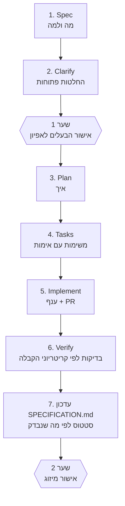

# פיתוח מונחה-אפיון (Spec-Driven) — תהליך העבודה

מכאן והלאה, כל פיצ'ר או שינוי משמעותי מתחיל באפיון ולא בקוד. המסמך הזה מגדיר את התהליך. מסמך הבסיס [`docs/SPECIFICATION.md`](../SPECIFICATION.md) הוא **מקור יחיד** למזהי הדרישות, לקריטריוני הקבלה ולסטטוס; אפיון פיצ'ר מפרט שינוי אחד ומתמזג לתוכו.

> **הערה כנה:** התהליך הזה הוצג אחרי שרוב המערכת כבר נבנתה. אפיון הבסיס נכתב בדיעבד, ופיצ'רים שפותחו לפני כן (למשל [001](001-service-availability/spec.md)) מתועדים בדיעבד ומסומנים כך.

## מחזור החיים


| שלב | תוצר | מי מאשר |
|---|---|---|
| 1. Spec | `spec.md`: בעיה, היקף, תרחישים, דרישות, קריטריוני קבלה | — |
| 2. Clarify | סעיף "החלטות פתוחות": כל מדיניות עסקית, קלינית, משפטית או מוצרית שלא הוכרעה. **Claude לא בוחר אותה**; הוא מציג אפשרויות וממליץ | הבעלים (ובמקרה קליני גם גורם מוסמך) |
| שער 1 | אפיון מאושר לפני קוד לשינוי משמעותי (ר' למטה) | **הבעלים** |
| 3. Plan | `plan.md`: גישה טכנית, קבצים, מיגרציה (הצעה בלבד), פריסה, שחזור, סיכונים | — |
| 4. Tasks | `tasks.md`: משימות קטנות, לכל אחת בדיקת אימות | — |
| 5-6. Implement + Verify | קוד ובדיקות בענף נפרד; כל קריטריון קבלה ממופה לבדיקה | CI |
| 7. עדכון | הדרישות ב-`SPECIFICATION.md`: סטטוס **רק** לפי מה שמומש ונבדק | — |
| שער 2 | מיזוג ל-`main` | **הבעלים** |

## מתי נדרש אפיון פיצ'ר
**נדרש (שער 1):** התנהגות חדשה למשתמש, שינוי בהרשאות או בגישה לנתונים, מיגרציה או הצעת SQL, שינוי בתיעוד רפואי או בהערכת סיכון, שינוי בסנכרון ואופליין, רכיב AI, שינוי בתהליך הזמנה או במצבי ביקור.
**לא נדרש:** תיקון באג שמחזיר התנהגות לדרישה קיימת (מציינים את מזהה הדרישה ב-PR), בדיקות בלבד, תיעוד, תלויות. תיקון באג שמגלה שהדרישה עצמה שגויה או חסרה מחזיר לשלב 1.

## כללים
1. **אפיון לפני קוד** לשינוי משמעותי. קוד שנכתב בלי אפיון מאושר לא ממוזג.
2. **מזהים קבועים.** דרישה חדשה מקבלת מזהה ב-`SPECIFICATION.md` באותו PR; מזהה אינו משתמש חוזר.
3. **כל PR מציין את מזהי הדרישות** שהוא נוגע בהן (תבנית ה-PR מחייבת). ללא מזהה: מסבירים למה.
4. **קריטריון קבלה = בדיקה.** כל קריטריון מופיע בתרחיש "בהינתן/כאשר/אז" וממופה לבדיקה אוטומטית, או מסומן במפורש "ידני" עם סיבה.
5. **סטטוס אמיתי בלבד:** מתוכננת, ממומשת, נבדקה, הופעלה. הצעת SQL שלא הוחלה נשארת "מתוכננת".
6. **אין בחירת מדיניות:** ספים קליניים, נוסחאות, ניסוח קליני, שמירת רשומות, הרשאות חדשות וכל החלטה עסקית נרשמות כ-`O-nn` וממתינות לבעלים.
7. **הגבלות קבועות:** בלי מיזוג, פריסה או שינוי במסד החי בלי אישור מפורש (ר' `CLAUDE.md`).

## מבנה התיקייה
```
docs/specs/
  README.md                  התהליך (המסמך הזה)
  _template/                 תבניות spec.md, plan.md, tasks.md להעתקה
  NNN-שם-הפיצ'ר/             אפיון פיצ'ר: spec.md, plan.md, tasks.md
```
`NNN` רץ בסדר עולה. הבדיקה `python scripts/check_docs.py` מוודאת שכל מזהה דרישה שמוזכר באפיוני הפיצ'רים קיים ב-`SPECIFICATION.md`.
